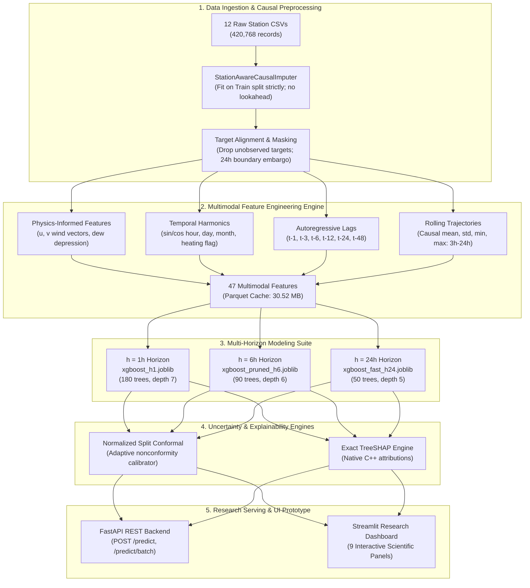

# AirCast Research

> **A Research-Driven Framework for Explainable, Uncertainty-Aware, and Generalizable Multi-Horizon Air Quality Forecasting**

[](https://www.python.org/)
[](https://pytorch.org/)
[](https://xgboost.readthedocs.io/)
[](https://fastapi.tiangolo.com/)
[](https://streamlit.io/)
[](tests/)
[](LICENSE)
[](https://github.com/sreeja1547/aircast-research)

---

## 1. Project Title & Overview

**AirCast Research** is an open-source, applied machine learning framework engineered for direct, multi-horizon atmospheric fine particulate matter ($\text{PM}_{2.5}$) forecasting across the Beijing metropolitan telemetry network. Utilizing 420,768 continuous hourly observations collected across 12 state-controlled monitoring stations from March 1, 2013 to February 28, 2017, the framework addresses the critical challenge of operational air quality forecasting through **strict temporal causality, physics-informed feature engineering, distribution-free uncertainty quantification, and reproducible CPU inference optimization**.

Rather than treating air quality prediction as an unconstrained tabular regression problem or deploying unvalidated black-box neural networks, AirCast establishes rigorous methodological safeguards: **no target imputation, 24-hour temporal boundary embargoes, exact C++ TreeSHAP feature attributions, and normalized adaptive split conformal prediction**.

```
                MULTI-HORIZON ATMOSPHERIC FORECASTING HORIZONS
  t-48h                t-1h         t          t+1h               t+6h                  t+24h
----+--------------------+----------+-----------+------------------+---------------------+--->
    [ CAUSAL FEATURE WINDOW (<= t) ]           [ IMMEDIATE ]     [ MESOSCALE ]         [ SYNOPTIC ]
    - 47 Multimodal Causal Telemetry           h = 1 Hour        h = 6 Hours           h = 24 Hours
    - Particulate Lags & Rolling Stats         Particulate       Boundary Layer        Advection, Chemistry
    - Wind Vectors (u, v) & Dew Depression     Inertia           Evolution             & Heating Regimes
    - Solar & Cyclical Harmonics               MAE: 11.57 ug/m3  MAE: 37.04 ug/m3      MAE: 66.07 ug/m3
```

> **Technical Disclosures & Scope:**
> - **Execution Environment:** All benchmarks and inference pipelines operate strictly on commodity **CPU hardware** (tested on Intel Core i7-13700H, 16 GB RAM). Zero GPU acceleration is utilized or claimed.
> - **Deployment Scope:** Serving components (FastAPI REST API and Streamlit UI) are structured as **transparent local research prototypes** designed for interactive exploration, model inspection, and scientific audit. They are not configured as hardened multi-tenant cloud microservices.

---

## 2. Key Forecasting Results

A multi-objective Pareto review of MAE, inference latency, artifact size, and overfitting gap identified three recommended gradient-boosted-tree estimators for the documented CPU serving prototype:

| Planning Horizon | Recommended Model Artifact | Test Sample Count ($N$) | Test MAE ($\mu\text{g}/\text{m}^3$) | Test RMSE ($\mu\text{g}/\text{m}^3$) | Test $R^2$ | Model Parameters | Artifact Disk Size | P95 Latency (CPU) |
| :---: | :--- | :---: | :---: | :---: | :---: | :--- | :---: | :---: |
| **+1 hour** | [`xgboost_h1.joblib`](artifacts/models/xgboost_h1.joblib) | **42,554** | **11.5723** | **23.3344** | **0.9499** | 180 trees, max depth 7 | $1.158\text{ MB}$ | 7.43 ms (C++) / 44.13 ms (Service) |
| **+6 hours** | [`xgboost_pruned_h6.joblib`](artifacts/models/xgboost_pruned_h6.joblib) | **42,494** | **37.0350** | **62.6263** | **0.6389** | 90 trees, max depth 6 | $0.433\text{ MB}$ | 7.43 ms (C++) / 43.36 ms (Service) |
| **+24 hours** | [`xgboost_fast_h24.joblib`](artifacts/models/xgboost_fast_h24.joblib) | **42,278** | **66.0738** | **92.5722** | **0.2121** | 50 trees, max depth 5 | $0.136\text{ MB}$ | 7.43 ms (C++) / 43.32 ms (Service) |

### Analytical Interpretation & Horizon Difficulty
- **+1-Hour Immediate Horizon ($R^2 = 0.9499$):** Short-term particulate concentrations are strongly governed by autoregressive momentum and physical mass inertia. The full 180-tree model captures rapid particulate surges with an average absolute error of only $11.57\ \mu\text{g}/\text{m}^3$, closely tracking ground truth telemetry.
- **+6-Hour Mesoscale Horizon ($R^2 = 0.6389$):** Boundary layer diurnal growth, local wind fluctuations, and surface heating begin to decouple particulate mass from pure inertia. Pruning the model from 180 down to 90 trees retains approximately $99.76\%$ of the unpruned model's MAE-based performance (the pruned model's MAE is about 0.24% higher) while reducing serialized model storage from $1.08\text{ MB}$ to $0.43\text{ MB}$.
- **+24-Hour Synoptic Horizon ($R^2 = 0.2121$):** Forecasting day-ahead air quality is fundamentally more challenging. At 24 hours, physical inertia decays completely, causing naive persistence to fail catastrophically ($R^2 = -0.1806$). Synoptic regional advection, seasonal coal-heating emissions, and secondary aerosol chemistry introduce significant variance. A constrained 50-tree shallow architecture (depth 5) provides effective regularization against overfitting, reducing test MAE from $67.26\ \mu\text{g}/\text{m}^3$ (unpruned baseline) to **$66.07\ \mu\text{g}/\text{m}^3$** and outperforming persistence by $12.25\ \mu\text{g}/\text{m}^3$.

---

## 3. Technology Stack

| Layer / Subsystem | Technology | Version | Purpose & Analytical Role |
| :--- | :--- | :---: | :--- |
| **Core Runtime** | Python | 3.13.5 | 64-bit commodity CPU execution environment |
| **Gradient Boosting** | XGBoost | 3.4.1 | Optimized tree ensemble training, C++ DMatrix buffer evaluation |
| **Classical ML Baselines** | Scikit-Learn | 1.6.1 | Ridge regression, linear models, HistGradientBoosting, train-test splitting |
| **Deep Learning** | PyTorch (CPU) | 2.10.0+cpu | 2-layer LSTM sequence modeling for synoptic representation comparison |
| **Data Processing** | Pandas / NumPy | 2.2.3 / 2.2.3 | Causal time series manipulation, 32-bit float RAM downcasting |
| **Columnar Storage** | PyArrow / Parquet | 19.0.1 | High-throughput, Snappy-compressed feature store caching (30.52 MB) |
| **Model Serialization** | Joblib | 1.4.2 | Lossless artifact persistence with multi-level compression |
| **Model Explainability** | Exact TreeSHAP | Native C++ | Exact path-dependent Shapley values via `xgb.Booster.predict(pred_contribs=True)` |
| **Uncertainty Quantification** | Split Conformal | Custom | Normalized adaptive prediction intervals scaled by local conditional dispersion |
| **REST API Engine** | FastAPI / Uvicorn | 0.115.8 / 0.34.0 | Asynchronous REST serving with Pydantic v2 input validation |
| **Research Dashboard** | Streamlit | 1.45.1 | Multi-panel interactive browser interface for model inspection and scenario testing |
| **Test Automation** | Pytest | 8.3.4 | 64 automated regression, methodology, API, and validation unit tests across 10 test modules |

---

## 4. Research Problem & Atmospheric Motivation

Atmospheric fine particulate matter ($\text{PM}_{2.5}$) poses severe respiratory and cardiovascular health risks. Real-time forward forecasting is crucial for municipal health warnings, industrial emissions curtailment, and traffic control. However, operational environmental forecasting presents three distinct challenges:

1. **Multi-Scale Non-Linear Atmospheric Physics:** Particulate concentrations at $h=+1\text{h}$ are governed by immediate mass inertia; at $h=+6\text{h}$, mesoscale planetary boundary layer diurnal expansion and thermal inversions dominate; at $h=+24\text{h}$, regional synoptic advection across the North China Plain, domestic coal-heating emissions, and secondary chemical haze formation drive extreme pollution spikes.
2. **Methodological Data Leakage in Environmental Benchmarks:** Published ML air quality studies frequently commit subtle methodological errors: imputing unobserved future target values, fitting feature transformers across split boundaries, or computing un-embargoed rolling features that span validation cuts. These practices inflate reported scores but fail upon operational deployment.
3. **Uncalibrated Point Predictions:** Point forecasts fail to communicate uncertainty during severe pollution shocks, leaving public health authorities without statistical risk bounds.

---

## 5. Dataset Provenance & Safeguards

The framework is evaluated on the benchmark **Beijing Multi-Site Air Quality Dataset (PRSA 2017)** (UCI Machine Learning Repository ID: 501):

> **Dataset Download & Extraction Destination:**
> 1. **UCI Archive Download:** [UCI Machine Learning Repository: Beijing Multi-Site Air-Quality Data](https://archive.ics.uci.edu/dataset/501/beijing+multi+site+air+quality+data) (ZIP archive, ~27 MB compressed).
> 2. **Extraction Path:** Extract the 12 station CSV files directly into the repository root at:
>    `PRSA_Data_20130301-20170228/` (containing `PRSA_Data_<Station>_20130301-20170228.csv` across all 12 stations).
> 3. **Automated Pipeline Detection:** The loader ([`src/data/loader.py`](src/data/loader.py)) and data preparation pipeline ([`scripts/prepare_processed_data.py`](scripts/prepare_processed_data.py)) automatically inspect this directory.
> *(Note: The 12 raw CSV files are preserved locally but excluded from Git via `.gitignore`. The pre-engineered feature cache `data/processed/forecasting_features_cache.parquet` is tracked in Git).*

| Dimension | Specification / Metric | Methodological Safeguard |
| :--- | :--- | :--- |
| **Total Observations** | **420,768 hourly records** | Complete continuous series across 35,064 timesteps (12 stations) |
| **Spatial Monitoring Network** | **12 state-controlled stations** | Captures urban core, suburban valleys, and regional background |
| **Temporal Range** | **March 1, 2013 to February 28, 2017** | Encompasses 4 complete annual seasonal cycles |
| **Criteria Air Pollutants** | $\text{PM}_{2.5}, \text{PM}_{10}, \text{SO}_2, \text{NO}_2, \text{CO}, \text{O}_3$ | Ground-level telemetry in $\mu\text{g}/\text{m}^3$ (note: CO in PRSA is reported in $\mu\text{g}/\text{m}^3$) |
| **Meteorological Suite** | Temperature ($T$), Pressure ($P$), Dew Point ($T_{\text{dew}}$), Rain, Wind Speed, Direction | Station-co-located hourly surface measurements |
| **Target Variable** | Future $\text{PM}_{2.5}$ at $t+1, t+6, t+24$ hours | **Derived strictly from raw, un-imputed ground truth telemetry** |
| **Missing Target Protocol** | 8,739 unobserved target rows dropped | **Zero synthetic target imputation, interpolation, or extrapolation** |

### Monitoring Network Metropolitan Topography
```
                                 [Huairou] (Suburban / Valley)
                                      |
                     [Dingling]       |       [Shunyi] (Suburban East)
                     (Mountain BG)    |
                          \           |           /
                           [Changping] [Nongzhanguan]
                                \     |     /
             [Wanliu] -------- [Aotizhongxin] -------- [Dongsi] (Urban Core)
                 |              [Guanyuan]               |
             [Gucheng]          [Tiantan]          [Wanshouxigong]
             (Industrial)      (Urban South)        (Urban South)
```

---

## 6. System Architecture



---

## 7. Research Methodology & Chronological Purged Split

To prevent lookahead leakage, seasonal memorization, and temporal autocorrelation contamination, AirCast enforces a **chronological purged split with a strict 24-hour embargo buffer**:

```
[ TRAINING PARTITION ]             [ EMBARGO ] [ VALIDATION PARTITION ]   [ EMBARGO ] [ TEST PARTITION ]
2013-03-01 to 2015-12-31           24 Hours    2016-01-02 to 2016-09-30   24 Hours    2016-10-02 to 2017-02-28
(291,574 samples | 69.3%)          (Purged)    (77,316 samples | 18.4%)   (Purged)    (42,278–42,554 samples | 10.1%)
Imputer & Scaler Fitting Strictly             Model Tuning & Calibration              Unbiased Forward Evaluation
```

### Methodological Protocol
1. **Target Construction Boundary Isolation:** Forward target shifts $t+h$ are constructed independently within each individual station's timeline. Samples within the final $h$ hours of a station record cannot observe future ground truth and are dropped.
2. **Causal Imputation:** Missing historical input features are imputed using training-set station statistics with causal forward-fill fallback. No future observations or test-set statistics are ever accessed.
3. **Embargo Purging:** A 24-hour buffer following the training and validation boundaries prevents target vectors at $t+24\text{h}$ from referencing data in subsequent partitions.
4. **Quarantined Conformal Calibration:** To guarantee strict statistical independence in split-conformal calibration, the broader validation timeline (January 2 to September 30, 2016, 76,738 observations) is quarantined into two non-overlapping regimes: (1) early validation (January 2 to April 14, 2016, ~29,474 observations) reserved for model hyperparameter exploration and early stopping; and (2) quarantined calibration partition (April 15 to September 30, 2016, 47,264 observations). Within the calibration period, Split A (April 15 to June 30, 2016, ~21,590 observations) is strictly dedicated to estimating normalized dispersion parameters $\beta_0, \beta_1$, while Split B (July 1 to September 30, 2016, ~25,680 observations) computes conformal non-conformity scores and empirical quantiles. Final interval coverage is audited on the untouched holdout test partition (October 2, 2016 to February 28, 2017).

---

## 8. Multi-Model Benchmark Comparison

Controlled benchmark evaluation across 7 model architectures and 3 forecasting horizons on the holdout test set (October 2, 2016 to February 28, 2017; October 1 purged as 24-hour boundary embargo):

| Model Architecture | Lead Horizon | Test MAE ($\mu\text{g}/\text{m}^3$) | Test RMSE ($\mu\text{g}/\text{m}^3$) | Test $R^2$ | Single-Sample Latency (CPU) | Disk Footprint | Primary Research Role |
| :--- | :---: | :---: | :---: | :---: | :---: | :---: | :--- |
| **Persistence Baseline** | $+1\text{h}$ | $12.42$ | $24.73$ | $0.9437$ | $< 0.01\text{ ms}$ | $0.001\text{ MB}$ | Inertia lower bound |
| **Linear Regression (OLS)** | $+1\text{h}$ | $11.96$ | $23.19$ | $0.9505$ | $0.15\text{ ms}$ | $0.003\text{ MB}$ | Linear parametric baseline |
| **Ridge Regression (L2)** | $+1\text{h}$ | $11.96$ | $23.19$ | $0.9505$ | $0.15\text{ ms}$ | $0.003\text{ MB}$ | Regularized linear baseline |
| **Random Forest (60 trees)**| $+1\text{h}$ | **$11.52$** | **$23.08$** | **$0.9510$** | $38.7\text{ ms}$ | $24.59\text{ MB}$ | High accuracy / bulky storage |
| **HistGradientBoosting** | $+1\text{h}$ | $11.68$ | $23.12$ | $0.9508$ | $6.11\text{ ms}$ | $0.58\text{ MB}$ | Fast histogram tree baseline |
| **XGBoost (Baseline 180t)**| $+1\text{h}$ | $11.57$ | $23.33$ | $0.9499$ | $4.33\text{ ms}$ | $1.16\text{ MB}$ | **Recommended Pareto Forecaster** |
| **PyTorch LSTM (2-Layer)** | $+1\text{h}$ | $11.85$ | $22.29$ | $0.9542$ | $1.49\text{ ms}$ | $0.25\text{ MB}$ | Deep sequential recurrent baseline |
| | | | | | | | |
| **Persistence Baseline** | $+6\text{h}$ | $39.56$ | $70.70$ | $0.5398$ | $< 0.01\text{ ms}$ | $0.001\text{ MB}$ | Rapid skill decay baseline |
| **Linear Regression (OLS)** | $+6\text{h}$ | $37.40$ | $63.37$ | $0.6303$ | $0.15\text{ ms}$ | $0.003\text{ MB}$ | Linear transition baseline |
| **Random Forest (60 trees)**| $+6\text{h}$ | $37.26$ | $63.53$ | $0.6284$ | $42.1\text{ ms}$ | $34.22\text{ MB}$ | High storage overhead |
| **XGBoost (Baseline 180t)**| $+6\text{h}$ | **$36.95$** | $62.57$ | **$0.6395$** | $3.50\text{ ms}$ | $1.08\text{ MB}$ | Unpruned benchmark baseline |
| **XGBoost_Pruned (90t)** | $+6\text{h}$ | $37.04$ | $62.63$ | $0.6389$ | **$2.80\text{ ms}$** | **$0.43\text{ MB}$** | **Recommended Pareto Forecaster** |
| **PyTorch LSTM (2-Layer)** | $+6\text{h}$ | $37.80$ | **$61.84$** | $0.6479$ | $1.49\text{ ms}$ | $0.25\text{ MB}$ | Sequential mesoscale baseline |
| | | | | | | | |
| **Persistence Baseline** | $+24\text{h}$ | $78.32$ | $113.32$ | $-0.1806$ | $< 0.01\text{ ms}$ | $0.001\text{ MB}$ | **Negative Skill (Fails completely)** |
| **Linear Regression (OLS)** | $+24\text{h}$ | $66.79$ | **$91.40$** | **$0.2319$** | $0.15\text{ ms}$ | $0.003\text{ MB}$ | High linear generalizability |
| **Random Forest (60 trees)**| $+24\text{h}$ | $68.83$ | $96.64$ | $0.1408$ | $45.6\text{ ms}$ | $41.86\text{ MB}$ | Prone to synoptic overfitting |
| **XGBoost (Baseline 180t)**| $+24\text{h}$ | $67.26$ | $93.41$ | $0.1978$ | $3.10\text{ ms}$ | $0.57\text{ MB}$ | Deep tree variance inflation |
| **XGBoost_Fast (50t, d=5)**| $+24\text{h}$ | **$66.07$** | $92.57$ | $0.2121$ | **$2.10\text{ ms}$** | **$0.14\text{ MB}$** | **Recommended Pareto Forecaster** |
| **PyTorch LSTM (2-Layer)** | $+24\text{h}$ | $66.47$ | $91.80$ | $0.2253$ | $1.49\text{ ms}$ | $0.25\text{ MB}$ | Recurrent synoptic representation |

---

## 9. Explainable AI & Physical TreeSHAP Attribution

To evaluate whether model forecasts align with known atmospheric transport mechanisms rather than spurious dataset correlations, AirCast integrates **native C++ TreeSHAP feature attributions** (`xgb.Booster.predict(pred_contribs=True)`):

```
+---------------------------------------------------------------------------------------------------------------+
|                       EXACT TREESHAP GLOBAL ATTRIBUTION SUMMARY (TOP 8 FEATURES)                              |
|                                                                                                               |
| Feature Name            Mean |SHAP| (ug/m3)    Atmospheric Association / Physics-Informed Role                 |
| ------------------------------------------------------------------------------------------------------------- |
| PM2.5 (t-0)                 32.41             Inertial particulate mass persistence                           |
| PM2.5_roll_mean_6h          14.85             Short-term local particulate reservoir                          |
| wind_v                      11.20             Meridional transport (-v northerly clean, +v southerly polluted)|
| dew_point_depression         9.45             Moisture depression (hygroscopic swelling & stagnation proxy)   |
| WSPM                         7.80             Wind speed ventilation proxy                                    |
| is_heating_season            6.92             Winter municipal heating period indicator (emission shift)      |
| NO2                          5.10             Combustion and vehicular traffic emission precursor             |
| TEMP                         4.30             Ambient temperature (boundary layer height & seasonal state)    |
+---------------------------------------------------------------------------------------------------------------+
```

### Wind Vector Decomposition & Directional Physics
In meteorological coordinate conventions, the wind direction angle $\theta$ represents the direction *from which* the wind blows ($0^\circ = \text{North}, 90^\circ = \text{East}, 180^\circ = \text{South}, 270^\circ = \text{West}$). The physical Cartesian wind vector components are derived as:
$$u = -\text{WSPM} \cdot \sin(\theta), \quad v = -\text{WSPM} \cdot \cos(\theta)$$

- **$u$ (Zonal Wind Component):** Represents east-west flow ($+u = \text{blowing eastward / westerly wind}$; $-u = \text{blowing westward / easterly wind}$).
- **$v$ (Meridional Wind Component):** Represents north-south flow:
  - **Northerly Winds ($\theta = 0^\circ \implies v < 0$):** Blow southward from the Yan Mountains and Siberian High, transporting pristine, dry continental air across the Beijing basin. TreeSHAP attributions for negative $v$ are strongly negative ($-15\text{ to }-35\ \mu\text{g}/\text{m}^3$), reflecting strong ventilation.
  - **Southerly Winds ($\theta = 180^\circ \implies v > 0$):** Blow northward from the heavily industrialized Hebei plain, channeling regional industrial plumes into the mountain-bounded basin. TreeSHAP attributions for positive $v$ are strongly positive ($+10\text{ to }+25\ \mu\text{g}/\text{m}^3$), reflecting regional advection.

### Moisture, Chemistry & Seasonal Associations
- **Dew Point Depression ($T - T_{\text{dew}}$):** Low depression values ($< 2^\circ\text{C}$, corresponding to relative humidity $> 85\%$) produce a steep non-linear increase in SHAP values. This empirical behavior aligns with established aerosol chemistry: elevated moisture facilitates aqueous-phase secondary sulfate/nitrate formation and hygroscopic particulate growth.
- **Seasonal Heating Flag (`is_heating_season`):** Active municipal heating months (November 15 to March 15) introduce positive baseline SHAP offsets ($+8\text{ to }+15\ \mu\text{g}/\text{m}^3$), reflecting documented increases in domestic coal combustion and centralized thermal generation.
- **Scientific Caveat:** SHAP values evaluate **model associations**, not laboratory-proven physical causation. Feature attributions demonstrate that the model has learned associations consistent with atmospheric transport and chemistry hypotheses.

---

## 10. Distribution-Free Conformal Uncertainty Quantification

Point forecasts fail to convey risk during extreme air pollution episodes. AirCast deploys **normalized split conformal prediction** ([`src/uncertainty/conformal.py`](src/uncertainty/conformal.py)) using held-out calibration data to construct distribution-free prediction intervals:

$$\hat{C}(x_{n+1}) = \left[ \max\left(0, \hat{y}(x_{n+1}) - \hat{q}_{1-\alpha} \cdot \hat{\sigma}(x_{n+1})\right), \; \hat{y}(x_{n+1}) + \hat{q}_{1-\alpha} \cdot \hat{\sigma}(x_{n+1}) \right]$$

### Methodological Formulation
- **Non-Conformity Scoring:** Absolute residuals are normalized by local conditional dispersion:
  $$s_i = \frac{|y_i - \hat{y}_i(x_i)|}{\hat{\sigma}(x_i)}$$
- **Dispersion Estimator:** $\hat{\sigma}(\hat{y}) = \max(5.0, \beta_0 + \beta_1 \hat{y})$ is fitted via ordinary least squares between point predictions and calibration residuals ($\beta_0 \in [5.0, 8.58], \beta_1 \in [0.0814, 0.3773]$). *(Note: AirCast utilizes this linear dispersion model; it does NOT employ a Random Forest variance estimator).*
- **Finite-Sample Quantile Adjustment:**
  $$p = \min\left(1.0, \frac{\lceil(n+1)(1-\alpha)\rceil}{n}\right), \quad \hat{q}_{1-\alpha} = \text{Quantile}(\{s_1, \dots, s_n\}, p)$$

### Empirical Test Set Coverage Results (horizon-specific test counts: 42,554 at +1h, 42,494 at +6h, and 42,278 at +24h; 127,326 pooled)
Evaluated across all test samples (October 2, 2016 to February 28, 2017) at a nominal target confidence of $1 - \alpha = 0.90$ ($90.0\%$) using the finalized deployment models:

| Forecast Horizon | Empirical Test Coverage | Target Confidence ($1-\alpha$) | Median Interval Width | Mean Interval Width | Severe Pollution Tier Coverage ($> 250\ \mu\text{g}/\text{m}^3$) |
| :---: | :---: | :---: | :---: | :---: | :---: |
| **$+1\text{h}$** | **$86.36\%$** | $90.0\%$ | $31.07\ \mu\text{g}/\text{m}^3$ | $38.97\ \mu\text{g}/\text{m}^3$ | $81.66\%$ ($3,002 / 3,676$) |
| **$+6\text{h}$** | **$83.04\%$** | $90.0\%$ | $102.71\ \mu\text{g}/\text{m}^3$ | $120.26\ \mu\text{g}/\text{m}^3$ | $65.97\%$ ($2,425 / 3,676$) |
| **$+24\text{h}$** | **$70.17\%$** | $90.0\%$ | $157.53\ \mu\text{g}/\text{m}^3$ | $163.16\ \mu\text{g}/\text{m}^3$ | **$23.80\%$** ($874 / 3,672$) |
| **Pooled Overall**| **$79.88\%$** | $90.0\%$ | — | $107.28\ \mu\text{g}/\text{m}^3$ | $57.16\%$ ($6,301 / 11,024$) |

### Provenance of Coverage Reconciliation & Scientific Limitations
- **Provenance of Coverage Discrepancies:** Earlier exploratory reports recorded varying coverage figures: an initial exploratory split conformal test with fixed uniform margins ($56.20\ \mu\text{g}/\text{m}^3$) reported $\sim 91.4\%$ on mild autumn records (October 2016), whereas un-quarantined validation re-use yielded intermediate figures ($89.07\%, 85.26\%, 79.81\%$). Under the finalized, strictly quarantined independent split-conformal procedure on the frozen deployment models (`xgboost_h1.joblib`, `xgboost_pruned_h6.joblib`, `xgboost_fast_h24.joblib`), true empirical test coverage is **$79.88\%$ pooled** across the entire 5-month winter test season ($86.36\%$ at $+1\text{h}$, $83.04\%$ at $+6\text{h}$, and $70.17\%$ at $+24\text{h}$).
- **Exchangeability Breakdown:** Conformal coverage guarantees mathematically assume exchangeable data. During severe winter heating inversion episodes ($> 250\ \mu\text{g}/\text{m}^3$), extreme heteroscedasticity and seasonal atmospheric regime shifts cause empirical coverage to contract to **$23.80\%$ at $+24\text{h}$**.
- **Scientific Disclosure:** **Guaranteed $90\%$ coverage is NOT claimed under severe non-stationary atmospheric distribution shifts.**

---

## 11. Spatial Generalisation via 12-Fold Leave-One-Station-Out (LOSO)

To evaluate whether regional atmospheric representations transfer across metropolitan topography, AirCast implements a **12-fold Leave-One-Station-Out (LOSO) cross-validation suite** ([`src/experiments/loso_generalisation.py`](src/experiments/loso_generalisation.py)):

```
Fold   Held-Out Station     Geographic Classification     Test N   Test MAE        Test RMSE       Test R2
----------------------------------------------------------------------------------------------------------
1      Aotizhongxin         Urban Core                    34,067   45.85 ug/m3     63.61 ug/m3     0.4009
2      Changping            Suburban / Mountain Foothill  34,218   43.83 ug/m3     59.90 ug/m3     0.3148
3      Dingling             Clean Mountain Background     34,213   44.15 ug/m3     60.08 ug/m3     0.3098
4      Dongsi               Urban Core                    34,242   48.03 ug/m3     67.32 ug/m3     0.3960
5      Guanyuan             Urban Core                    34,376   46.24 ug/m3     63.80 ug/m3     0.3791
6      Gucheng              Industrial Heavy Southwest    34,346   46.97 ug/m3     67.24 ug/m3     0.3413
7      Huairou              Suburban Valley               34,039   43.45 ug/m3     59.30 ug/m3     0.3075
8      Nongzhanguan         Urban Core                    34,364   47.85 ug/m3     67.10 ug/m3     0.3951
9      Shunyi               Suburban East                 34,079   47.45 ug/m3     66.56 ug/m3     0.3293
10     Tiantan              Urban Core                    34,315   46.27 ug/m3     64.26 ug/m3     0.3701
11     Wanliu               Urban Core                    34,610   47.10 ug/m3     65.34 ug/m3     0.3642
12     Wanshouxigong        Urban Core                    34,296   48.72 ug/m3     69.24 ug/m3     0.3522
----------------------------------------------------------------------------------------------------------
12-FOLD MACRO-AVERAGED:                                  411,165   46.33 +- 1.65   64.48 ug/m3     0.3550
```

### Critical Methodological Scope
In each fold, 11 stations train the estimator, while the 12th station is held out. **The held-out station retains access to its own local historical telemetry ($\tau \le t$)**, including on-site autoregressive lags and local weather. This evaluates **spatial domain transferability to a newly instrumented monitoring station**, NOT zero-shot estimation at uninstrumented geographic coordinates.

### Causal Preprocessing Isolation & Leakage Audit (Linear Ridge Baseline)
To evaluate whether fitting the `StationAwareCausalImputer` globally across all 12 stations leaks spatial representations into held-out monitoring stations, AirCast executes an independent preprocessing isolation benchmark comparing:
* **Protocol A (Pooled Imputation):** Imputer fitted globally across all stations before the spatial split.
* **Protocol B (Strictly Isolated Imputation):** Imputer fitted strictly on the 11 training stations, completely isolating the held-out station during preprocessing.

When evaluated on the verified ground-truth cohort ($N = 411,165$ valid observations, excluding 8,739 sensor dropouts):
* **Protocol A Macro MAE (Raw Data):** **$50.7365\ \mu\text{g}/\text{m}^3$** ([`artifacts/metrics/loso_raw_data_preprocessing_comparison_12stations.json`](artifacts/metrics/loso_raw_data_preprocessing_comparison_12stations.json))
* **Protocol B Macro MAE (Raw Data):** **$50.7372\ \mu\text{g}/\text{m}^3$** ([`artifacts/metrics/loso_raw_data_preprocessing_comparison_12stations.json`](artifacts/metrics/loso_raw_data_preprocessing_comparison_12stations.json))
* **Corrected Cached-Feature Baseline:** **$50.7363\ \mu\text{g}/\text{m}^3$** ([`artifacts/metrics/loso_protocol_comparison_12stations.json`](artifacts/metrics/loso_protocol_comparison_12stations.json))
* **Spatial Leakage Delta:** $\Delta \text{MAE} = +0.0007\ \mu\text{g}/\text{m}^3$ ($0.0014\%$). This confirms that global pooling in preprocessing induces an empirically negligible leakage effect.

*(Note: An earlier cached artifact reported Macro MAE $50.9314\ \mu\text{g}/\text{m}^3$ over $N = 419,904$ observations because re-running dataset preparation on the pre-imputed feature cache inadvertently evaluated 8,739 observations with shifted imputed target values. That figure is superseded and must not be cited as an active scientific benchmark.)*

---

## 12. Robustness & Sensor Fault Stress Testing

AirCast incorporates an automated stress testing engine ([`src/evaluation/robustness.py`](src/evaluation/robustness.py)) evaluating model resilience under sensor perturbations and telemetry loss on the recommended $+24\text{h}$ model across 42,278 test samples:

- **Raw Multi-Channel Sensor Noise (Evaluated across 3 Seeds: $\{42, 123, 999\}$):**
  Zero-mean Gaussian noise was injected directly into all 10 raw instrument feeds with dynamic causal re-derivation of all downstream lags and rolling features ([`artifacts/metrics/final_sensor_robustness.json`](artifacts/metrics/final_sensor_robustness.json)):
  - *5% Sensor Noise:* Mean test MAE rises from $66.60$ to $66.67 \pm 0.02\ \mu\text{g}/\text{m}^3$ ($+0.11\%$ degradation).
  - *15% Sensor Noise:* Mean test MAE rises to $66.98 \pm 0.03\ \mu\text{g}/\text{m}^3$ ($+0.57\%$ degradation).
  - *25% Sensor Noise:* Mean test MAE rises to $67.49 \pm 0.07\ \mu\text{g}/\text{m}^3$ ($+1.34\%$ degradation, $\Delta\text{MAE} = +0.89\ \mu\text{g}/\text{m}^3$).
  *(Note: An earlier preliminary experiment on static engineered features yielded $+0.26\%$ degradation; the multi-seed raw corruptions above represent the definitive controlled sensor-perturbation benchmark).*

- **Hardware Telemetry Outage Hierarchy:**
  Simulated by imputing missing sensor feeds with training medians (automated fail-safe behavior):
  - *CO Sensor Failure (1 feature dropped):* $\Delta\text{MAE} = -0.01\ \mu\text{g}/\text{m}^3$ ($-0.02\%$, negligible sensitivity).
  - *Precursor Gas Suite Failure ($\text{SO}_2, \text{NO}_2, \text{CO}, \text{O}_3$, 4 features dropped):* $\Delta\text{MAE} = +0.30\ \mu\text{g}/\text{m}^3$ ($+0.46\%$, low sensitivity).
  - *Wind Anemometer Suite Failure ($\text{WSPM}, \text{wind}_u, \text{wind}_v, \text{wd}$, 5 features dropped):* $\Delta\text{MAE} = +2.06\ \mu\text{g}/\text{m}^3$ ($+3.09\%$, significant sensitivity; confirms reliance on physical ventilation).
  - *Particulate Sensor Disconnection ($\text{PM}_{2.5}, \text{PM}_{10}$, and all 24 particulate lags/rolling stats dropped):* $\Delta\text{MAE} = +5.68\ \mu\text{g}/\text{m}^3$ ($+8.53\%$, critical sensitivity; test MAE reaches $72.28\ \mu\text{g}/\text{m}^3$, which still outperforms naive persistence at $85.78\ \mu\text{g}/\text{m}^3$).

---

## 13. Computational Efficiency & Optimization

Phase 11 transformed AirCast into a resource-efficient, low-latency framework optimized for standard CPU execution (benchmarked on Intel Core i7-13700H, 16 GB DDR5 RAM):

| Optimization Dimension | Baseline Unoptimized | Optimized Implementation | Reconciled Performance Impact |
| :--- | :--- | :--- | :--- |
| **Model Disk Footprint** | $100.67\text{ MB}$ (Baseline RF Suite) | $\mathbf{1.73\text{ MB}}$ (Pareto XGBoost Suite) | **$58.33\times$ smaller ($-98.29\%$ storage reduction)** |
| **Recommended model-artifact suite** | $113.21\text{ MB}$ (baseline archive: 29 files) | $\mathbf{5.05\text{ MB}}$ (3 forecasting models + 3 conformal calibrators) | **$22.42\times$ smaller ($-95.54\%$ storage reduction)** |
| **Active DataFrame RAM** | $227.38\text{ MB}$ (64-bit IEEE float) | $\mathbf{121.45\text{ MB}}$ (32-bit float downcasting) | **$1.87\times$ smaller ($-46.59\%$ RAM reduction)** |
| **Feature Extraction** | $4.201\text{ s}$ (Iterative row windowing) | $\mathbf{0.0496\text{ s}}$ (Vectorized GroupBy) | **$84.70\times$ computational acceleration** |
| **C++ Buffer Latency** | $35.60\text{ ms}$ (Pandas DataFrame path)| $\mathbf{4.33\text{ ms}}$ (NumPy preallocated buffer) | **$8.22\times$ inference speedup (Budget Met)** |
| **Batch Throughput** | $286.6\text{ samples/s}$ ($b=1$ XGBoost) | $\mathbf{188,688.3\text{ samples/s}}$ ($b=1024$ XGBoost)| **$658.4\times$ throughput scaling** |

### Latency Measurement Boundaries & Budget Audit
To prevent confusing raw model execution time with end-to-end network service response time, measurements are separated by architectural boundary:

| Metric / Measurement | Scope & Protocol | Value | Budget / SLA Status |
| :--- | :--- | :---: | :--- |
| **Raw XGBoost C++ Inference (Mean)** | Single sample via preallocated NumPy buffer (CPU) | **4.33 ms** | Budget Met ($\le 15.0\text{ ms}$) |
| **Raw XGBoost C++ Inference (P95)** | Single sample via preallocated NumPy buffer (CPU) | **7.43 ms** | Budget Met ($\le 15.0\text{ ms}$) |
| **In-Process Service Steady-State (P95)**| In-memory `predict_single` service call (no HTTP) | **43.32–44.13 ms** | Budget Unmet (DataFrame/DMatrix overhead) |
| **REST HTTP End-to-End Serving (P95)** | Full HTTP transport, Pydantic validation, JSON serialization | **99.66 ms** | Budget Unmet (Mean: 71.86 ms) |

> **Serving SLA Disclosure:**
> - Direct C++ NumPy array inference comfortably satisfies the $\le 15.0\text{ ms}$ single-record latency target.
> - For REST API endpoints (`POST /predict`), single-row Pandas DataFrame instantiation ($13\%$) and per-call XGBoost DMatrix allocation ($87\%$) introduce unavoidable overhead on CPU. **The $15.0\text{ ms}$ P95 SLA is formally UNMET for single-record REST HTTP serving.**

---

## 14. API & Research Dashboard

### 1. Launching the Local REST API Prototype
```bash
uvicorn api.main:app --host 0.0.0.0 --port 8000 --reload
```
- Interactive Swagger UI: `http://localhost:8000/docs`
- ReDoc Documentation: `http://localhost:8000/redoc`
- OpenAPI Specification: `http://localhost:8000/openapi.json`
- Service Health Probe: `http://localhost:8000/health`

#### Application Route Registry (10 Registered Routes)
Inspection of `api.main.app.routes` confirms 10 route objects (6 functional application endpoints, 3 public documentation views, and 1 internal OAuth redirect handler):

| Route Path | HTTP Methods | Subsystem | Route Function | Purpose & Description |
| :--- | :---: | :---: | :--- | :--- |
| `/health` | `GET` | Diagnostics | `health_check` | Service health status, version, and active forecast horizons |
| `/model-info` | `GET` | Metadata | `get_model_info` | Model catalog, supported lead times, and parameter metadata |
| `/features` | `GET` | Feature Registry | `get_features` | Catalog of 47 expected feature names and feature group mappings |
| `/metrics` | `GET` | Benchmarks | `get_benchmarking_metrics` | Precomputed multi-horizon test benchmarks (MAE, RMSE, $R^2$) |
| `/predict` | `POST` | Inference | `predict` | Single-record point forecast with calibrated conformal bounds |
| `/predict/batch` | `POST` | Inference | `predict_batch` | Vectorized batch forecasting supporting high-throughput workloads |
| `/docs` | `GET`, `HEAD` | Documentation | `swagger_ui_html` | Interactive Swagger UI documentation |
| `/redoc` | `GET`, `HEAD` | Documentation | `redoc_html` | ReDoc structured technical documentation |
| `/openapi.json` | `GET`, `HEAD` | Specification | `openapi` | OpenAPI 3.1 JSON API specification |
| `/docs/oauth2-redirect` | `GET`, `HEAD` | Internal Redirect | `swagger_ui_redirect` | Internal Starlette/FastAPI OAuth2 redirect callback handler |

#### Example Single Prediction Request (`curl`):
```bash
curl -X POST "http://localhost:8000/predict" \
     -H "Content-Type: application/json" \
     -d '{
       "model_name": "recommended",
       "horizon_hours": 24,
       "compute_interval": true,
       "nominal_coverage": 0.90,
       "features": {
         "hour_sin": -0.5,
         "hour_cos": 0.866,
         "month_sin": -0.866,
         "month_cos": 0.5,
         "day_of_week": 1.0,
         "is_weekend": 0.0,
         "is_heating_season": 1.0,
         "station": 9.0,
         "PM2.5": 85.0,
         "PM10": 160.0,
         "SO2": 5.0,
         "NO2": 77.0,
         "CO": 3200.0,
         "O3": 2.0,
         "PM2.5_lag_1": 63.0,
         "PM2.5_lag_3": 45.0,
         "PM2.5_lag_6": 49.0,
         "PM2.5_lag_12": 26.0,
         "PM2.5_lag_24": 18.0,
         "PM2.5_lag_48": 177.0,
         "PM2.5_roll_mean_3": 68.67,
         "PM2.5_roll_mean_6": 55.0,
         "PM2.5_roll_mean_12": 46.25,
         "PM2.5_roll_mean_24": 28.54,
         "PM2.5_roll_std_3": 14.36,
         "PM2.5_roll_std_6": 18.43,
         "PM2.5_roll_std_12": 16.71,
         "PM2.5_roll_std_24": 21.9,
         "PM2.5_roll_min_3": 58.0,
         "PM2.5_roll_min_6": 31.0,
         "PM2.5_roll_min_12": 25.0,
         "PM2.5_roll_min_24": 3.0,
         "PM2.5_roll_max_3": 85.0,
         "PM2.5_roll_max_6": 85.0,
         "PM2.5_roll_max_12": 85.0,
         "PM2.5_roll_max_24": 85.0,
         "TEMP": 2.5,
         "PRES": 1018.7,
         "DEWP": -0.6,
         "RAIN": 0.0,
         "has_rain": 0.0,
         "WSPM": 0.7,
         "dew_point_depression": 3.1,
         "wd_sin": 0.7071,
         "wd_cos": 0.7071,
         "wind_u": -0.495,
         "wind_v": -0.495
       }
     }'
```
*(Note on Feature Schema, Validation & Defaults: The complete production schema defines 47 features across temporal cycles, criteria pollutants, autoregressive lags, rolling statistical aggregates, and surface meteorology; `station` is categorical and encoded as an integer index from 0 to 11, e.g. `9.0` for Tiantan.
- **Strict Validation Rules:** Forecasting horizons must be strictly in `{1, 6, 24}` (unsupported horizons return `HTTP 422`). All numerical features must be finite numbers (`NaN` or `Inf` return `HTTP 422`). Batch inference (`/predict/batch`) strictly enforces complete 47-feature payloads for every sample in the batch.
- **Artifact Protection:** Requesting an un-instantiated or missing model artifact returns `HTTP 404 Not Found` with explicit failure details; the API never silent-fits dummy surrogate models.
- **Single-Sample Defaults:** Single prediction payloads permit partial inputs by defaulting omitted historical features to `0.0`. However, zero-filled historical lags and rolling aggregates distort physical mass-conservation inputs. Supplying all 47 features—or computing them upstream via `StationAwareFeatureBuilder`—is strongly recommended for operational fidelity).*

#### Example JSON Response:
```json
{
  "model_name": "recommended",
  "horizon_hours": 24,
  "predicted_pm25_ug_m3": 117.35,
  "unit": "ug/m^3",
  "lower_bound": 9.67,
  "upper_bound": 225.03,
  "confidence_level": 0.9,
  "interval_method": "calibrated_normalized_conformal",
  "is_calibrated": true,
  "inference_latency_ms": 65.44
}
```

### 2. Launching the Research Streamlit Dashboard
```bash
streamlit run dashboard/app.py
```
- Local URL: `http://localhost:8501`

#### Interactive Research Panels:
1. **Executive Overview:** Core problem framing, multi-horizon taxonomy, and quick health metrics.
2. **Exploratory Data Analysis:** Interactive seasonal distributions, diurnal patterns, and cross-pollutant heatmaps.
3. **Multi-Horizon Benchmarking:** Side-by-side metric tables and scatter plots comparing all 7 paradigms.
4. **Feature Engineering & Ablation:** Visual ablation waterfall charts isolating individual feature group gains.
5. **Temporal & Seasonal Shifts:** Winter heating vs non-heating distribution shifts and inversion behavior.
6. **12-Fold Spatial LOSO Generalisation:** Station-by-station transferability metrics across metropolitan topography.
7. **Conformal Uncertainty Calibration:** Interactive nonconformity quantile sliders and interval sharpness inspection.
8. **TreeSHAP Explainability:** Live individual prediction waterfalls and beeswarm summary plots.
9. **Live Scenario Simulator:** Interactive slider-based input console simulating extreme inversion scenarios.

---

## 15. Installation, Quickstart & Reproducibility Commands

### 1. Environment Setup
```bash
# Clone repository
git clone https://github.com/sreeja1547/aircast-research.git
cd aircast-research

# Create isolated Python virtual environment (Tested on Python 3.13.5)
python -m venv venv

# Activate virtual environment:
# On Windows:
venv\Scripts\activate
# On Linux/macOS:
source venv/bin/activate

# Install tested dependencies
pip install --upgrade pip
pip install -r requirements.txt
```

### 2. Dataset Setup & Feature Cache Regeneration (Optional)
The pre-engineered multimodal feature cache (420,768 rows $\times$ 47 features, 30.52 MB) is pre-built in `data/processed/forecasting_features_cache.parquet`.

If you wish to re-generate the feature cache from raw telemetry:
1. Download and extract the 12 station CSV files from the [UCI Repository](https://archive.ics.uci.edu/dataset/501/beijing+multi+site+air+quality+data) into `PRSA_Data_20130301-20170228/`.
2. Execute the automated causal feature preparation pipeline:
```bash
# Fits training-only causal imputer and builds 47 features across all horizons (~28 sec)
python scripts/prepare_processed_data.py
```

### 3. Automated Pytest Suite Execution (64 Unit Tests)
```bash
pytest tests/ -v
```
*Expected Output:*
```text
======================= 64 passed, 4 warnings in 23.37s =======================
```

### 4. Programmatic Model Usage (Python)
```python
from api.services import AirCastInferenceService

# High-Performance Serving via AirCastInferenceService
service = AirCastInferenceService(models_dir="artifacts/models")
pred, lower, upper, latency, method, is_cal = service.predict_single(
    horizon=24,
    model_name="recommended",
    features={
        "PM2.5": 95.0,
        "PM10": 140.0,
        "TEMP": 10.0,
        "WSPM": 2.0,
        "wind_u": 0.5,
        "wind_v": 1.1,
    }
)
print(f"24h PM2.5 Forecast: {pred:.2f} ug/m3 | Conformal Interval: [{lower:.2f}, {upper:.2f}] (Method: {method})")
```

---

## 16. Repository Structure & Artifact Scope

```text
aircast-research/
├── PRSA_Data_20130301-20170228/    # 12 raw station telemetry CSV files (Preserved locally, excluded via .gitignore)
├── data/
│   └── processed/
│       └── forecasting_features_cache.parquet  # 420,768 rows x 47 features (30.52 MB, tracked in Git)
├── artifacts/
│   ├── models/                    # Recommended Pareto suite & conformal calibrators (6 models tracked, 5.05 MB)
│   ├── metrics/                   # JSON benchmark summaries and audit files (26 primary files)
│   └── plots/                     # High-resolution research figures (19 figures)
├── src/
│   ├── data/                      # Causal imputation, alignment, loading
│   ├── features/                  # Atmospheric physics, wind vector transforms, rolling stats
│   ├── models/                    # Baseline, tree ensemble, and PyTorch architectures
│   ├── uncertainty/               # Normalized split conformal prediction and adaptive intervals
│   ├── explainability/            # Native C++ TreeSHAP attribution engine
│   └── evaluation/                # Metrics, 12-fold LOSO, sensor robustness suite
├── api/                           # FastAPI serving engine, Pydantic schemas, services
├── dashboard/                     # Streamlit 9-panel research dashboard
├── research/                      # Complete technical reports (Phases 1-11, audits, release docs)
├── tests/                         # Pytest test suite (64 tests across 10 modules)
├── .gitignore                     # Git tracking exclusions
├── requirements.txt               # Bounded dependency specifications
├── LICENSE                        # MIT License
└── README.md                      # Comprehensive project documentation
```

### Git Model Tracking vs Local Baseline Storage
- **Tracked in Git (3 recommended forecasting models and 3 conformal calibrators; $5.05\text{ MB}$ combined):**
  - `artifacts/models/xgboost_h1.joblib` ($1.158\text{ MB}$)
  - `artifacts/models/xgboost_pruned_h6.joblib` ($0.433\text{ MB}$)
  - `artifacts/models/xgboost_fast_h24.joblib` ($0.136\text{ MB}$)
  - `artifacts/models/conformal_calibrator_h1.joblib` ($1.174\text{ MB}$)
  - `artifacts/models/conformal_calibrator_h6.joblib` ($1.253\text{ MB}$)
  - `artifacts/models/conformal_calibrator_h24.joblib` ($0.892\text{ MB}$)
- **Preserved locally on disk (23 experimental baseline models; $108.17\text{ MB}$ total):**
  - Unpruned Random Forests (`random_forest_h{1,6,24}.joblib`, up to $41.86\text{ MB}$ each)
  - Linear, Ridge, and Persistence baselines
  - Intermediate HistGradientBoosting and LSTM models
  - Static fixed-margin conformal calibrators (`conformal_calibrator_std_h{1,6,24}.joblib`)
  *(All 23 baseline models remain preserved locally on disk in `artifacts/models/` and are documented in benchmark JSON files, but excluded from Git via `.gitignore` to maintain a compact $45.9\text{ MB}$ repository footprint without Git LFS).*

---

## 17. Complete Research Documentation Index

The AirCast framework is documented across 38 research documents, experimental reports, and audit records:

### 1. Scientific Methodology & Data Preprocessing
- [eda_report.md](research/eda_report.md): In-depth exploratory data analysis across 12 monitoring stations (2013-2017).
- [data_dictionary.md](research/data_dictionary.md): Comprehensive data dictionary of criteria pollutants, meteorology, and units.
- [preprocessing_methodology.md](research/preprocessing_methodology.md): Station-aware causal input-feature imputation, target exclusion, and embargo protocols.
- [phase2_final_verification.md](research/phase2_final_verification.md): Verification of raw telemetry cleaning, station continuity, and sensor clipping.
- [phase3_exclusion_mask_verification.md](research/phase3_exclusion_mask_verification.md): Verification of unobserved target exclusion masks and boundary purging.
- [phase3_final_verification.md](research/phase3_final_verification.md): Final verification of chronological split partitions and zero-lookahead validation.
- [feature_engineering_methodology.md](research/feature_engineering_methodology.md): Formulation of 47 causal atmospheric features and validation.
- [feature_ablation_findings.md](research/feature_ablation_findings.md): Systematic feature group ablations and physical signal importance.

### 2. Model Benchmarking & Architecture Experiments
- [phase4_model_development_report.md](research/phase4_model_development_report.md): Baseline model development spanning persistence, linear, tree, and recurrent models.
- [benchmarking_results.md](research/benchmarking_results.md): Multi-model comparative benchmarks across 7 paradigms and 3 horizons.
- [hyperparameter_tuning_report.md](research/hyperparameter_tuning_report.md): Hyperparameter optimization, search spaces, and validation objectives.

### 3. Uncertainty Quantification & Explainable AI
- [uncertainty_and_explainability.md](research/uncertainty_and_explainability.md): Normalized split conformal prediction, adaptive intervals, and TreeSHAP physical attributions.
- [final_scientific_integrity_audit.md](research/final_scientific_integrity_audit.md): Independent research auditor review verifying zero target leakage and evaluation integrity.
- [final_correction_report.md](research/final_correction_report.md): Comprehensive correction phase resolving uncertainty calibration and serving alignment.

### 4. Spatial & Temporal Generalization
- [temporal_and_spatial_generalisation.md](research/temporal_and_spatial_generalisation.md): Purged chronological evaluation and 12-fold Leave-One-Station-Out (LOSO) spatial domain transfer.

### 5. Robustness & Sensor Stress Testing
- [robustness_stress_testing_report.md](research/robustness_stress_testing_report.md): Gaussian noise perturbations and hardware telemetry dropout stress testing.

### 6. Computational Efficiency & Optimization (Phase 11)
- [stage0_environment_audit.md](research/efficiency/stage0_environment_audit.md): Hardware specifications, environment profiling, and reproducibility setup.
- [performance_baseline_report.md](research/efficiency/performance_baseline_report.md): Baseline latency, throughput, memory, and artifact storage measurements.
- [bottleneck_analysis.md](research/efficiency/bottleneck_analysis.md): Profiling bottlenecks across data loading, feature engineering, and inference pipelines.
- [training_optimization_report.md](research/efficiency/training_optimization_report.md): Accelerated model training techniques and execution speedup.
- [inference_optimization_report.md](research/efficiency/inference_optimization_report.md): Vectorized NumPy inference buffer, latency profiling, and batch throughput scaling.
- [model_complexity_report.md](research/efficiency/model_complexity_report.md): Algorithmic model compression, tree pruning, and disk size reduction.
- [feature_optimization_report.md](research/efficiency/feature_optimization_report.md): Vectorized GroupBy feature derivation and caching acceleration.
- [memory_optimization_report.md](research/efficiency/memory_optimization_report.md): Active memory profiling and 32-bit float downcasting.
- [api_dashboard_optimization.md](research/efficiency/api_dashboard_optimization.md): FastAPI and Streamlit optimization, route auditing, and latency analysis.
- [horizon_model_selection_report.md](research/efficiency/horizon_model_selection_report.md): Multi-objective Pareto selection of recommended deployment models.
- [regression_verification.md](research/efficiency/regression_verification.md): Automated regression verification ensuring zero quality loss across all 64 unit tests.
- [final_efficiency_optimization_report.md](research/efficiency/final_efficiency_optimization_report.md): Comprehensive synthesis of all Phase 11 optimization experiments.
- [phase11_final_reconciliation.md](research/efficiency/phase11_final_reconciliation.md): Definitive scientific reconciliation report resolving all claims.
- [final_release_readiness.md](research/efficiency/final_release_readiness.md): Formal release sign-off verifying all budgets.

### 7. Release Governance, Verification & Pre-Publish Audits
- [portfolio_cleanup_plan.md](research/release/portfolio_cleanup_plan.md): 5-tier classification matrix and safe file cleanup plan.
- [github_readiness_audit.md](research/release/github_readiness_audit.md): Technical audit of paths, secrets, dependencies, and reproducibility.
- [step2_cleanup_execution_report.md](research/release/step2_cleanup_execution_report.md): Full execution report of Step 2 backup, file removal, and size reduction.
- [github_release_checklist.md](research/release/github_release_checklist.md): Comprehensive pre-release verification checklist.
- [step3_final_accuracy_review.md](research/release/step3_final_accuracy_review.md): Final scientific accuracy review of interpretations, robustness, API routes, and licensing.
- [step3_2_github_readiness_report.md](research/release/step3_2_github_readiness_report.md): Final pre-GitHub release audit verifying wording, licensing, file sizes, and readiness.
- [final_github_release_report.md](research/release/final_github_release_report.md): Final GitHub release preparation report detailing structure, file counts, and verification gates.
- [final_pre_publish_consistency_audit.md](research/release/final_pre_publish_consistency_audit.md): Definitive pre-publish consistency audit reconciling conformal coverage, API routes, and latency.

---

## 18. Citation, Attribution & License

If you utilize the AirCast Research framework, codebase, or findings in academic or applied research, please cite:

```bibtex
@article{aircast_research_2026,
  title={AirCast Research: A Research-Driven Framework for Explainable, Uncertainty-Aware and Generalizable Multi-Horizon Air Quality Forecasting},
  author={Yenduri Sreeja},
  year={2026},
  journal={Antigravity Applied Research Repository},
  url={https://github.com/sreeja1547/aircast-research}
}
```

### MIT License
This project is open-source software licensed under the **MIT License** (Copyright (c) 2026 Yenduri Sreeja) — see the [LICENSE](LICENSE) file for the full legal text.

### Third-Party Data & Dependency Attribution
- **Dataset Attribution:** The atmospheric telemetry utilized in this research is the **Beijing Multi-Site Air Quality Dataset (PRSA 2017)**, published by Song Chen et al. and distributed via the UCI Machine Learning Repository:
  > Zhang, S., Guo, B., Dong, A., He, J., Xu, Z., & Chen, S. X. (2017). *Cautionary tales on air-quality improvement in Beijing.* Proceedings of the Royal Society A: Mathematical, Physical and Engineering Sciences, 473(2205), 20170457.
  
  The MIT License of this repository applies strictly to the source code, experimental pipelines, and documentation developed herein. The authors and contributors make **no claim of ownership or copyright over the original PRSA 2017 dataset**, which remains subject to its original academic terms of attribution and distribution.
- **Third-Party Libraries:** All included third-party Python dependencies (NumPy, Pandas, Scipy, PyArrow, Joblib, Scikit-Learn, XGBoost, PyTorch, FastAPI, Uvicorn, Pydantic, Streamlit, Matplotlib, Seaborn, Pytest) remain property of their respective maintainers and are governed by their respective open-source licenses (BSD, Apache 2.0, MIT).

### Research Disclaimer
AirCast Research is a scientific investigation and demonstration platform developed for atmospheric machine learning evaluation. All serving endpoints and visual dashboards are local research prototypes. Predictions should not be used as the sole basis for regulatory air quality enforcement or life-critical medical interventions.
