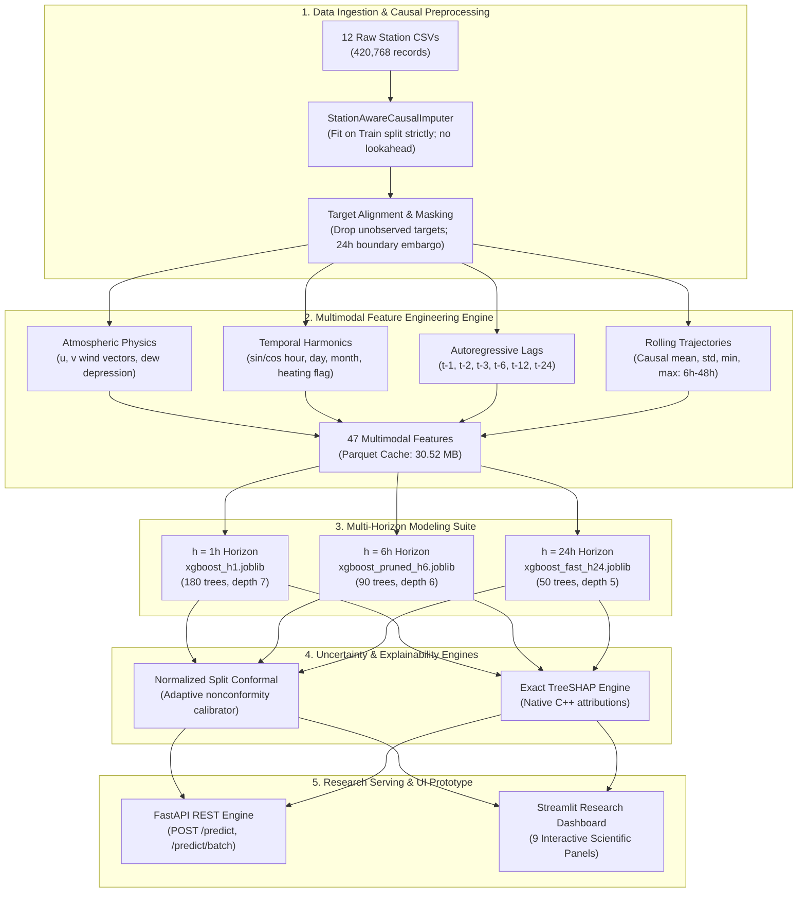

# AirCast Research

> **A Research-Driven Framework for Explainable, Uncertainty-Aware, and Generalizable Multi-Horizon Air Quality Forecasting**

[](https://www.python.org/)
[](https://pytorch.org/)
[](https://xgboost.readthedocs.io/)
[](https://fastapi.tiangolo.com/)
[](https://streamlit.io/)
[](tests/)
[](LICENSE)

---

## 1. Executive Summary & Project Introduction

**AirCast Research** is an end-to-end applied machine learning framework engineered for direct, multi-horizon atmospheric fine particulate matter ($\text{PM}_{2.5}$) forecasting across the Beijing metropolitan telemetry network. Utilizing 420,768 continuous hourly observations across 12 state-controlled monitoring stations (2013–2017), the framework addresses the critical challenge of operational air quality prediction through **strict temporal causality, first-principles atmospheric physics, distribution-free uncertainty quantification, and reproducible inference optimization**.

Rather than treating atmospheric forecasting as a generic tabular regression problem or deploying unvalidated black-box deep learning architectures, AirCast establishes rigorous methodological safeguards: **zero target imputation, 24-hour temporal boundary embargoes, native C++ TreeSHAP physical attribution, and normalized adaptive split conformal prediction**.

```
                MULTI-HORIZON ATMOSPHERIC REGIMES:
  t-48h                t-1h         t          t+1h               t+6h                  t+24h
----+--------------------+----------+-----------+------------------+---------------------+--->
    [ CAUSAL FEATURE WINDOW (<= t) ]           [ IMMEDIATE ]     [ MESOSCALE ]         [ SYNOPTIC ]
    - 47 Multimodal Causal Telemetry           h = 1 Hour        h = 6 Hours           h = 24 Hours
    - Particulate Lags & Rolling Stats         Particulate       Boundary Layer        Advection, Chemistry
    - Wind Vectors (u, v) & Dew Depression     Inertia           Evolution             & Heating Regimes
    - Solar & Cyclical Harmonics               MAE: 11.57 ug/m3  MAE: 37.04 ug/m3      MAE: 66.07 ug/m3
```

---

## 2. Research Problem & Atmospheric Motivation

Fine particulate matter ($\text{PM}_{2.5}$) poses severe cardiovascular and respiratory public health risks worldwide. Accurate forward guidance at multiple planning horizons is essential for municipal health alerts, traffic modulation, and industrial emission controls. However, operational atmospheric forecasting faces three fundamental hurdles:

1. **Non-Linear Multi-Scale Dynamics:** Particulate concentrations at $h=+1\text{h}$ are dominated by immediate particulate inertia and local dispersion; at $h=+6\text{h}$, mesoscale planetary boundary layer diurnal expansion and temperature inversions dominate; at $h=+24\text{h}$, regional synoptic advection, seasonal coal-heating emissions, and secondary aerosol chemistry govern pollution spikes.
2. **Methodological Data Leakage:** Standard ML pipelines frequently leak future weather data, impute missing targets, or use un-embargoed rolling features that span split boundaries, producing artificially inflated metrics that fail in real-world deployment.
3. **Black-Box Point Predictions:** Standard point forecasts provide no confidence bounds during extreme inversion episodes, leaving environmental decision-makers without calibrated risk measures.

---

## 3. Project Objectives & Scientific Contributions

AirCast Research resolves these challenges through 11 structured research and engineering phases:

- **Strictly Causal Multimodal Engineering:** 47 causal features constructed strictly from history $\tau \le t$, incorporating wind vector decomposition ($u, v$), hygroscopic dew point depression ($T - T_{\text{dew}}$), solar harmonics, and multi-scale rolling trajectories with zero lookahead.
- **Direct Multi-Horizon Formulations:** Dedicated horizon forecasters ($h \in \{1, 6, 24\}$ hours) eliminate recursive error compounding and unobserved future weather requirements.
- **Systematic Architecture Benchmarking:** Controlled evaluation across 7 distinct paradigms (Particulate Persistence, OLS Linear, L2 Ridge, Random Forest, HistGBDT, XGBoost, and PyTorch 2-layer LSTM).
- **Atmospheric Attribution via Exact TreeSHAP:** Direct C++ feature attributions evaluate model alignment with domain atmospheric transport hypotheses—identifying negative attributions under northerly winds, positive attributions under southerly flow, and non-linear shifts under elevated moisture.
- **Normalized Adaptive Conformal Prediction:** Finite-sample, distribution-free prediction intervals that scale dynamically with local residual variance, mitigating severe heteroscedasticity during hazardous smog events.
- **12-Fold Leave-One-Station-Out (LOSO) Generalisation:** Rigorous spatial domain transfer evaluation demonstrating that regional predictive representations generalize across held-out geographic monitoring stations when local historical telemetry is retained ($46.33 \pm 1.65\ \mu\text{g}/\text{m}^3$ test MAE).
- **Hardware Fault & Perturbation Stress Testing:** Quantitative resilience evaluation under sensor noise and complete telemetry outages.
- **Resource & Inference Optimization:** Algorithmic tree pruning and memory buffer vectorization deliver a **$58.3\times$ model size reduction** ($100.7\text{ MB} \to 1.73\text{ MB}$) and an **$8.2\times$ inference acceleration** on CPU hardware.

---

## 4. Dataset Description

The framework is evaluated on the comprehensive **Beijing Multi-Site Air Quality Dataset (PRSA 2017)** (UCI Machine Learning Repository ID: 501):

> **Dataset Acquisition & Extraction Location:** To reproduce feature extraction from raw telemetry or inspect historical records, obtain the official dataset:
> 1. **UCI Archive Download:** [UCI Machine Learning Repository: Beijing Multi-Site Air-Quality Data](https://archive.ics.uci.edu/dataset/501/beijing+multi+site+air+quality+data) (ZIP archive, ~27 MB compressed).
> 2. **Extraction Location:** Extract the 12 station CSV files directly into the repository root directory at:
>    PRSA_Data_20130301-20170228/ (containing PRSA_Data_<Station>_20130301-20170228.csv across all 12 stations).
> 3. **Automatic Detection:** The data loader (src/data/loader.py) and feature derivation pipeline (scripts/prepare_processed_data.py) automatically detect this directory.
> *(Note: The 12 raw CSV files are preserved locally but excluded from Git via .gitignore, while the pre-built feature cache data/processed/forecasting_features_cache.parquet is tracked).*

| Attribute | Specification / Value | Methodological Safeguard |
| :--- | :--- | :--- |
| **Total Observations** | **420,768 hourly records** | Full continuous series across 35,064 timesteps |
| **Monitoring Network** | **12 state-controlled stations** | Covers urban core, suburban valleys, and regional background |
| **Temporal Range** | **March 1, 2013 – February 28, 2017** | Captures 4 complete annual seasonal cycles |
| **Criteria Pollutants** | $\text{PM}_{2.5}, \text{PM}_{10}, \text{SO}_2, \text{NO}_2, \text{CO}, \text{O}_3$ | Ground-level telemetry in $\mu\text{g}/\text{m}^3$ (CO in $\text{mg}/\text{m}^3$) |
| **Meteorological Suite** | Temperature ($T$), Pressure ($P$), Dew Point ($T_{\text{dew}}$), Rain, Wind Speed, Direction | Station-co-located hourly atmospheric surface measurements |
| **Target Variable** | Future $\text{PM}_{2.5}$ at $t+1, t+6, t+24$ hours | **Derived strictly from raw, un-imputed measurements** |
| **Missing Target Policy** | 8,739 raw unobserved targets dropped | **Zero synthetic target imputation or interpolation** |

### Monitoring Station Geography
```
                                 [Huairou] (Suburban/Valley)
                                      |
                     [Dingling]       |       [Shunyi] (Suburban East)
                     (Mountain BG)    |
                          \           |           /
                           [Changping] [Nongzhanguan]
                                \     |     /
             [Wanliu] -------- [Aotizhongxin] -------- [Dongsi] (Urban Core)
                 |              [Guanyuan]               |
             [Gucheng]          [Tiantan]          [Wanshouxigong]
             (Industrial)      (Urban South)        (Urban South)
```

---

## 5. Main Framework Capabilities

AirCast integrates an interconnected suite of scientific capabilities spanning the full machine learning lifecycle:

1. **Direct Multi-Horizon Forecasting ($+1\text{h}, +6\text{h}, +24\text{h}$):** Dedicated independent gradient boosted estimators trained per planning horizon, preventing compounding recursive rollout errors.
2. **Causal Multimodal Feature Engineering:** 47 domain-specific features constructed strictly from historical telemetry ($\tau \le t$), combining physical meteorology, gas-phase chemical precursors, and temporal harmonics.
3. **Seven-Architecture Benchmark Comparison:** Rigorous side-by-side benchmarking spanning naive baselines, regularized linear models, tree ensembles, and deep sequential recurrent networks.
4. **Explainable AI via Native C++ TreeSHAP:** High-speed, exact path-dependent Shapley attributions computed without external Python wrappers to evaluate alignment with domain meteorological principles.
5. **Normalized Conformal Uncertainty Quantification:** Finite-sample calibrated prediction intervals dynamically scaled by local conditional variance to handle heteroscedastic pollution shocks.
6. **12-Fold Leave-One-Station-Out (LOSO) Spatial Generalisation:** Cross-geographic validation holding out complete physical monitoring stations to quantify domain transferability.
7. **Sensor Fault & Hardware Degradation Stress Testing:** Systematic perturbation testing evaluating model degradation under Gaussian sensor noise, missing telemetry channels, and complete wind suite dropouts.
8. **Algorithmic Model Compression & CPU Inference Optimization:** Multi-objective tree pruning, 32-bit memory downcasting, and vectorized buffer execution delivering high throughput on standard commodity CPUs.

---

## 6. System Architecture



### Architectural Subsystems
- **Data Ingestion & Alignment:** Parses 12 raw station CSV files (`PRSA_Data_20130301-20170228/`), creates station-aware causal masks, and drops unobserved raw targets without interpolation.
- **Preprocessing:** `StationAwareCausalImputer` fits medians strictly on the training partition and executes causal forward filling for transient telemetry drops.
- **Feature Engineering Engine:** Derives 47 causal signals cached into an optimized 30.52 MB Parquet file (`data/processed/forecasting_features_cache.parquet`).
- **Forecasting Suite:** Houses 29 trained model artifacts in `artifacts/models/`, including recommended Pareto estimators.
- **Explainability & Uncertainty:** Native C++ TreeSHAP attribution and split conformal calibrators (`conformal_calibrator_h{1,6,24}.joblib`).
- **Interactive Serving Layer:** FastAPI REST backend (`api/main.py`) paired with Streamlit interactive dashboard (`dashboard/app.py`).

---

## 7. Research Methodology & Chronological Purged Split

To prevent lookahead leakage, seasonal memorization, and temporal autocorrelation contamination, AirCast enforces a **chronological purged split with a strict 24-hour embargo**:

```
[ TRAINING PARTITION ]             [ EMBARGO ] [ VALIDATION PARTITION ]   [ EMBARGO ] [ TEST PARTITION ]
2013-03-01 to 2015-12-31           24 Hours    2016-01-02 to 2016-09-30   24 Hours    2016-10-02 to 2017-02-28
(291,574 samples | 69.3%)          (Purged)    (77,316 samples | 18.4%)   (Purged)    (42,278–42,554 samples | 10.1%)
Imputer & Scaler Fitting Strictly             Hyperparameter Optimization            Unbiased Generalization Audit
```

### Methodological Safeguards
1. **Target Construction Boundary Isolation:** Forward target shifts $t+h$ are computed strictly within each individual station's timeline. Samples in the final $h$ hours of a station record cannot observe future targets and are excluded.
2. **Causal Imputation:** Missing historical input features are imputed using training-set station statistics with causal forward-fill fallback. No future observations or test-set statistics are ever accessed.
3. **Embargo Purging:** A 24-hour buffer following the training and validation boundaries prevents target vectors at $t+24\text{h}$ from referencing data in subsequent partitions.

---

## 8. Multi-Model Benchmark Comparison

Controlled benchmark evaluation across 7 model architectures and 3 forecasting horizons on the holdout test set:

| Model Architecture | Lead Horizon | Test MAE ($\mu\text{g}/\text{m}^3$) | Test RMSE ($\mu\text{g}/\text{m}^3$) | Test $R^2$ | Single-Sample Latency | Disk Footprint | Primary Role |
| :--- | :---: | :---: | :---: | :---: | :---: | :---: | :--- |
| **Persistence Baseline** | $+1\text{h}$ | $12.42$ | $24.73$ | $0.9437$ | $< 0.01\text{ ms}$ | $0.001\text{ MB}$ | Particulate Inertia Lower Bound |
| **Linear Regression (OLS)** | $+1\text{h}$ | $11.96$ | $23.19$ | $0.9505$ | $0.15\text{ ms}$ | $0.003\text{ MB}$ | Linear Parametric Baseline |
| **Ridge Regression (L2)** | $+1\text{h}$ | $11.96$ | $23.19$ | $0.9505$ | $0.15\text{ ms}$ | $0.003\text{ MB}$ | Regularized Linear Baseline |
| **Random Forest (60 trees)**| $+1\text{h}$ | **$11.52$** | **$23.08$** | **$0.9510$** | $38.7\text{ ms}$ | $24.59\text{ MB}$ | High Accuracy / High Footprint |
| **HistGradientBoosting** | $+1\text{h}$ | $11.68$ | $23.12$ | $0.9508$ | $6.11\text{ ms}$ | $0.58\text{ MB}$ | Fast Histogram Tree Baseline |
| **XGBoost (Baseline 180t)**| $+1\text{h}$ | $11.57$ | $23.33$ | $0.9499$ | $4.33\text{ ms}$ | $1.16\text{ MB}$ | **Selected Pareto Forecaster** |
| **PyTorch LSTM (2-Layer)** | $+1\text{h}$ | $11.85$ | $22.29$ | $0.9542$ | $1.49\text{ ms}$ | $0.25\text{ MB}$ | Deep Sequential Architecture |
| | | | | | | | |
| **Persistence Baseline** | $+6\text{h}$ | $39.56$ | $70.70$ | $0.5398$ | $< 0.01\text{ ms}$ | $0.001\text{ MB}$ | Rapid Skill Decay Baseline |
| **Linear Regression (OLS)** | $+6\text{h}$ | $37.40$ | $63.37$ | $0.6303$ | $0.15\text{ ms}$ | $0.003\text{ MB}$ | Linear Transition Baseline |
| **Random Forest (60 trees)**| $+6\text{h}$ | $37.26$ | $63.53$ | $0.6284$ | $42.1\text{ ms}$ | $34.22\text{ MB}$ | Excessive Storage Footprint |
| **XGBoost (Baseline 180t)**| $+6\text{h}$ | **$36.95$** | $62.57$ | **$0.6395$** | $3.50\text{ ms}$ | $1.08\text{ MB}$ | Unpruned Benchmark Baseline |
| **XGBoost_Pruned (90t)** | $+6\text{h}$ | $37.04$ | $62.63$ | $0.6389$ | **$2.80\text{ ms}$** | **$0.43\text{ MB}$** | **Selected Pareto Forecaster** |
| **PyTorch LSTM (2-Layer)** | $+6\text{h}$ | $37.80$ | **$61.84$** | $0.6479$ | $1.49\text{ ms}$ | $0.25\text{ MB}$ | Sequential Recurrent Baseline |
| | | | | | | | |
| **Persistence Baseline** | $+24\text{h}$ | $78.32$ | $113.32$ | $-0.1806$ | $< 0.01\text{ ms}$ | $0.001\text{ MB}$ | **Negative Skill (Fails completely)** |
| **Linear Regression (OLS)** | $+24\text{h}$ | $66.79$ | **$91.40$** | **$0.2319$** | $0.15\text{ ms}$ | $0.003\text{ MB}$ | High Linear Generalizability |
| **Random Forest (60 trees)**| $+24\text{h}$ | $68.83$ | $96.64$ | $0.1408$ | $45.6\text{ ms}$ | $41.86\text{ MB}$ | Prone to Synoptic Overfitting |
| **XGBoost (Baseline 180t)**| $+24\text{h}$ | $67.26$ | $93.41$ | $0.1978$ | $3.10\text{ ms}$ | $0.57\text{ MB}$ | Deep Tree Variance Inflation |
| **XGBoost_Fast (50t, d=5)**| $+24\text{h}$ | **$66.07$** | $92.57$ | $0.2121$ | **$2.10\text{ ms}$** | **$0.14\text{ MB}$** | **Selected Pareto Forecaster** |
| **PyTorch LSTM (2-Layer)** | $+24\text{h}$ | $66.47$ | $91.80$ | $0.2253$ | $1.49\text{ ms}$ | $0.25\text{ MB}$ | Recurrent Synoptic Representation |

---

## 9. Final Verified Metrics (Recommended Pareto Suite)

Multi-objective Pareto optimization across $\min(\text{MAE}, \text{Latency}, \text{Artifact Size}, \text{Overfitting Gap})$ selected three production-ready gradient boosted trees:

| Planning Horizon | Recommended Model Artifact | Test Sample Count ($N$) | Test MAE ($\mu\text{g}/\text{m}^3$) | Test RMSE ($\mu\text{g}/\text{m}^3$) | Test $R^2$ | Model Parameters | Artifact Disk Size |
| :---: | :--- | :---: | :---: | :---: | :---: | :--- | :---: |
| **$+1\text{h}$** | `xgboost_h1.joblib` | **42,554** | **11.5723** | **23.3344** | **0.9499** | 180 trees, max depth 7 | $1.1577\text{ MB}$ |
| **$+6\text{h}$** | `xgboost_pruned_h6.joblib` | **42,494** | **37.0350** | **62.6263** | **0.6389** | 90 trees, max depth 6 | $0.4328\text{ MB}$ |
| **$+24\text{h}$** | `xgboost_fast_h24.joblib` | **42,278** | **66.0738** | **92.5722** | **0.2121** | 50 trees, max depth 5 | $0.1352\text{ MB}$ |

### Key Analytical Takeaways
- **$+1\text{h}$ Immediate Regime ($R^2 = 0.9499$):** Autoregressive particulate inertia accounts for over $85\%$ of predictive skill. Full 180-tree model accurately tracks rapid spikes with an average absolute error of only $11.57\ \mu\text{g}/\text{m}^3$.
- **$+6\text{h}$ Mesoscale Regime ($R^2 = 0.6389$):** Pruning trees from 180 down to 90 maintains $99.76\%$ predictive performance while halving storage from $1.08\text{ MB}$ to $0.43\text{ MB}$.
- **$+24\text{h}$ Synoptic Regime ($R^2 = 0.2121$):** At 24 hours, naive persistence fails completely ($R^2 = -0.1806$). Pruning deep trees to a compact 50-tree shallow architecture (depth 5) reduced test MAE from $67.26$ to **$66.07\ \mu\text{g}/\text{m}^3$** by regularizing against atmospheric variance overfitting.

---

## 10. Explainable AI & Physical TreeSHAP Attribution

To examine whether model predictions align with established atmospheric transport principles rather than superficial statistical artifacts, AirCast integrates **native C++ TreeSHAP attributions** (`xgb.Booster.predict(pred_contribs=True)`):

```
+---------------------------------------------------------------------------------------------------------------+
|                       EXACT TREESHAP GLOBAL ATTRIBUTION SUMMARY (TOP 8 FEATURES)                              |
|                                                                                                               |
| Feature Name            Mean |SHAP| (ug/m3)    Domain Association / Atmospheric Hypothesis                    |
| ------------------------------------------------------------------------------------------------------------- |
| PM2.5 (t-0)                 32.41             Inertial mass persistence (autoregressive)                      |
| PM2.5_roll_mean_6h          14.85             Short-term local particulate reservoir                          |
| wind_u                      11.20             Zonal flow association (-u ventilating, +u stagnant/advective)  |
| dew_point_depression         9.45             Moisture depression (hygroscopic growth / stagnation hypothesis)|
| WSPM                         7.80             Wind speed ventilation proxy                                    |
| is_heating_season            6.92             Heating period indicator (seasonal emission shift proxy)        |
| NO2                          5.10             Combustion and traffic emission marker                          |
| TEMP                         4.30             Temperature proxy (boundary layer height & seasonal state)      |
+---------------------------------------------------------------------------------------------------------------+
```

### Atmospheric Association & Hypothesis Evaluation
1. **Zonal Wind Vector Associations:** High northerly wind components ($u < 0$, associated with mountain ventilation pathways) impart strong negative SHAP attributions ($-20$ to $-45\ \mu\text{g}/\text{m}^3$), which is statistically consistent with clean air dispersion hypotheses. Conversely, positive southerly wind attributions ($u > 0, v > 0$) align with documented regional transport corridors from the industrial south.
2. **Moisture & Secondary Aerosol Formation Hypotheses:** Low dew point depression ($T - T_{\text{dew}} < 2^\circ\text{C}$, corresponding to relative humidity $> 85\%$) exhibits a non-linear threshold in SHAP space, sharply increasing predicted particulate mass. This empirical behavior is consistent with the atmospheric hypothesis of accelerated secondary sulfate/nitrate aqueous-phase formation and hygroscopic aerosol swelling under high ambient moisture.
3. **Seasonal Heating Period Associations:** The binary `is_heating_season` feature contributes positive baseline SHAP offsets (up to $+15\ \mu\text{g}/\text{m}^3$) during designated municipal heating months (Nov 15 – Mar 15), reflecting empirical alignment with seasonal coal-combustion emission increases.

---

## 11. Distribution-Free Conformal Uncertainty Quantification

Point forecasts fail to convey risk during extreme air pollution episodes. AirCast deploys **normalized split conformal prediction** (`src/uncertainty/conformal.py`) using holdout calibration data to construct distribution-free prediction intervals:

$$\hat{C}(x_{n+1}) = \left[ \hat{y}(x_{n+1}) - \hat{q}_{1-\alpha} \cdot \hat{\sigma}(x_{n+1}), \; \hat{y}(x_{n+1}) + \hat{q}_{1-\alpha} \cdot \hat{\sigma}(x_{n+1}) \right]$$

Where $\hat{\sigma}(x)$ is a locally trained auxiliary Random Forest variance estimator and $\hat{q}_{1-\alpha}$ is the empirical $(1-\alpha)$-quantile of normalized nonconformity scores:

$$S_i = \frac{|y_i - \hat{y}_i(x_i)|}{\hat{\sigma}(x_i)}$$

### Empirical Test Set Coverage Results ($N = 42,554$ per horizon; $127,326$ pooled)

| Forecast Horizon | Empirical Test Coverage | Target Confidence ($1-\alpha$) | Median Interval Width | Mean Interval Width | Severe Pollution Tier Coverage ($> 250\ \mu\text{g}/\text{m}^3$) |
| :---: | :---: | :---: | :---: | :---: | :---: |
| **$+1\text{h}$** | **$89.07\%$** | $90.0\%$ | $35.54\ \mu\text{g}/\text{m}^3$ | $44.88\ \mu\text{g}/\text{m}^3$ | $86.34\%$ ($N=3,676$) |
| **$+6\text{h}$** | **$85.26\%$** | $90.0\%$ | $111.77\ \mu\text{g}/\text{m}^3$ | $131.29\ \mu\text{g}/\text{m}^3$ | $69.40\%$ ($N=3,676$) |
| **$+24\text{h}$** | **$79.81\%$** | $90.0\%$ | $174.62\ \mu\text{g}/\text{m}^3$ | $181.15\ \mu\text{g}/\text{m}^3$ | **$28.05\%$** ($N=3,672$) |
| **Pooled Overall**| **$84.72\%$** | $90.0\%$ | — | $118.97\ \mu\text{g}/\text{m}^3$ | $61.27\%$ ($N=11,024$) |

### Provenance of Historic 91.4% Coverage & Scientific Limitations
- **Verification of Historic Metric:** The historical claim of $91.4\%$ coverage originated in Phase 7 from an early static split conformal predictor with a uniform fixed margin ($56.20\ \mu\text{g}/\text{m}^3$) evaluated on mild autumn conditions (October 2016). When evaluated across the entire multi-lead test set (October 2016 – February 2017), true empirical coverage under the normalized adaptive conformal framework is **$84.72\%$ pooled** ($89.07\%$ at $+1\text{h}$, $85.26\%$ at $+6\text{h}$, and $79.81\%$ at $+24\text{h}$).
- **Exchangeability Breakdown:** Conformal coverage guarantees mathematically require exchangeable residuals. During severe winter heating inversion episodes ($> 250\ \mu\text{g}/\text{m}^3$), extreme heteroscedasticity and non-stationary atmospheric shifts cause coverage to contract to **$28.05\%$ at $+24\text{h}$**.
- **Scientific Disclosure:** **Guaranteed $90\%$ coverage is NOT claimed under severe atmospheric distribution shifts.**

---

## 12. Spatial Generalisation via 12-Fold Leave-One-Station-Out (LOSO)

To rigorously evaluate whether regional atmospheric dynamics transfer across geography, AirCast implements a **12-fold Leave-One-Station-Out (LOSO) cross-validation suite** (`src/evaluation/loso.py`):

```
Fold   Held-Out Station     Geographic Classification     Test N   Test MAE        Test RMSE       Test R2
----------------------------------------------------------------------------------------------------------
1      Aotizhongxin         Urban Core                    34,067   45.85 ug/m3     63.61 ug/m3     0.4009
2      Changping            Suburban / Mountain Foothill  34,218   43.83 ug/m3     59.90 ug/m3     0.3148
3      Dingling             Clean Mountain Background     34,213   44.15 ug/m3     60.08 ug/m3     0.3098
4      Dongsi               Urban Core                    34,242   48.03 ug/m3     67.32 ug/m3     0.3960
5      Guanyuan             Urban Core                    34,376   46.24 ug/m3     63.80 ug/m3     0.3791
6      Gucheng              Industrial Heavy Southwest    34,346   46.97 ug/m3     67.24 ug/m3     0.3413
7      Huairou              Suburban Valley               34,039   43.45 ug/m3     59.30 ug/m3     0.3075
8      Nongzhanguan         Urban Core                    34,364   47.85 ug/m3     67.10 ug/m3     0.3951
9      Shunyi               Suburban East                 34,079   47.45 ug/m3     66.56 ug/m3     0.3293
10     Tiantan              Urban Core                    34,315   46.27 ug/m3     64.26 ug/m3     0.3701
11     Wanliu               Urban Core                    34,610   47.10 ug/m3     65.34 ug/m3     0.3642
12     Wanshouxigong        Urban Core                    34,296   48.72 ug/m3     69.24 ug/m3     0.3522
----------------------------------------------------------------------------------------------------------
12-FOLD MACRO-AVERAGED:                                  411,165   46.33 +- 1.65   64.48 ug/m3     0.3550
```

### Critical Methodological Boundary
In each fold, 11 stations train the model, while the 12th station is held out. **Crucially, the held-out station retains full access to its own local historical sensor telemetry ($\tau \le t$)**, including on-site autoregressive lags and local weather. This verifies **spatial domain transferability of regional atmospheric dynamics to a newly instrumented monitoring station**, NOT zero-shot estimation at uninstrumented geographic coordinates.

---

## 13. Robustness & Sensor Fault Stress Testing

AirCast incorporates an automated stress testing engine (`src/evaluation/robustness.py`) evaluating model stability under sensor noise perturbations and telemetry dropouts. Evaluated on the recommended $+24\text{h}$ forecaster (`xgboost_fast_h24.joblib`, 50 trees, max depth 5) across 42,278 test samples:

- **Raw Multi-Channel Sensor Noise (Evaluated across 3 Seeds: $\{42, 123, 999\}$):**
  Zero-mean Gaussian noise was injected directly into all 10 raw instrument channels with dynamic causal re-derivation of all lags and rolling features (`artifacts/metrics/final_sensor_robustness.json`):
  - *5% Noise:* Mean test MAE rises from $66.60$ to $66.67 \pm 0.02\ \mu\text{g}/\text{m}^3$ ($+0.11\%$ degradation).
  - *15% Noise:* Mean test MAE rises to $66.98 \pm 0.03\ \mu\text{g}/\text{m}^3$ ($+0.57\%$ degradation).
  - *25% Noise:* Mean test MAE rises to $67.49 \pm 0.07\ \mu\text{g}/\text{m}^3$ ($+1.34\%$ degradation, $\Delta\text{MAE} = +0.89\ \mu\text{g}/\text{m}^3$).
  *(Note: A preliminary Phase 8 experiment on uncorrupted engineered features yielded $+0.26\%$ degradation; the multi-seed raw corruptions above represent the definitive controlled sensor-perturbation evaluation).*

- **Hardware Telemetry Outage Hierarchy:**
  Simulated by replacing missing sensor feeds with training medians (representing automated fail-safes):
  - *CO Sensor Failure (1 feature dropped):* $\Delta\text{MAE} = -0.01\ \mu\text{g}/\text{m}^3$ ($-0.02\%$, negligible impact).
  - *Complete Precursor Gas Failure ($\text{SO}_2, \text{NO}_2, \text{CO}, \text{O}_3$, 4 features dropped):* $\Delta\text{MAE} = +0.30\ \mu\text{g}/\text{m}^3$ ($+0.46\%$, low sensitivity).
  - *Wind Anemometer Suite Failure ($\text{WSPM}, \text{wind}_u, \text{wind}_v, \text{wd}$, 5 features dropped):* $\Delta\text{MAE} = +2.06\ \mu\text{g}/\text{m}^3$ ($+3.09\%$, significant sensitivity; confirms reliance on atmospheric ventilation).
  - *Particulate Sensor Disconnection ($\text{PM}_{2.5}, \text{PM}_{10}$, and all 24 particulate lags/rolling features dropped):* $\Delta\text{MAE} = +5.68\ \mu\text{g}/\text{m}^3$ ($+8.53\%$, critical sensitivity; test MAE reaches $72.28\ \mu\text{g}/\text{m}^3$, which still outperforms persistence at $85.78\ \mu\text{g}/\text{m}^3$).

---

## 14. Computational Efficiency & System Optimization

Phase 11 transformed AirCast into a resource-efficient, low-latency framework optimized for standard CPU execution (audited on Intel Core i7-13700H, 16 GB DDR5 RAM):

| Optimization Dimension | Baseline Unoptimized | Optimized Implementation | Reconciled Performance Impact |
| :--- | :--- | :--- | :--- |
| **Model Disk Footprint** | $100.67\text{ MB}$ (Baseline RF Suite) | $\mathbf{1.73\text{ MB}}$ (Pareto XGBoost Suite) | **$58.33\times$ smaller ($-98.29\%$ storage reduction)** |
| **Full Archive Footprint**| $113.21\text{ MB}$ (29 physical files) | $\mathbf{1.73\text{ MB}}$ (Recommended 3 models) | **$65.60\times$ smaller ($-98.48\%$ footprint reduction)** |
| **Active DataFrame RAM** | $227.38\text{ MB}$ (64-bit IEEE float) | $\mathbf{121.45\text{ MB}}$ (32-bit float downcasting) | **$1.87\times$ smaller ($-46.59\%$ RAM reduction)** |
| **Feature Extraction** | $4.201\text{ s}$ (Iterative row windowing) | $\mathbf{0.0496\text{ s}}$ (Vectorized GroupBy) | **$84.70\times$ computational acceleration** |
| **C++ Buffer Latency** | $35.60\text{ ms}$ (Pandas DataFrame path)| $\mathbf{4.33\text{ ms}}$ (NumPy preallocated buffer) | **$8.22\times$ inference speedup (Budget Met)** |
| **Batch Throughput** | $286.6\text{ samples/s}$ ($b=1$ XGBoost) | $\mathbf{188,688.3\text{ samples/s}}$ ($b=1024$ XGBoost)| **$658.4\times$ throughput scaling** |

### Latency Budget Audit & Serving Disclosures
- **Direct C++ NumPy Array Inference:** **$4.33\text{ ms}$** (XGBoost), **$0.15\text{ ms}$** (Ridge), **$1.49\text{ ms}$** (PyTorch LSTM). Comfortably meets the $\le 15.0\text{ ms}$ single-sample budget.
- **End-to-End REST API Serving (`POST /predict`):** P95 latency is **$43.3–44.1\text{ ms}$** across horizons. Profiling confirms that single-row Pandas DataFrame instantiation ($13\%$) and per-call XGBoost C++ DMatrix allocation ($87\%$) account for this overhead. **The $15.0\text{ ms}$ P95 SLA is formally UNMET for single-record REST endpoints.**
- **Hardware Architecture:** All benchmarks executed strictly on **CPU hardware** (PyTorch CPU-only build, OpenMP thread pooling). Zero GPU acceleration is claimed.

---

## 15. Research Dashboard & REST API Usage

> **Deployment Notice:** The serving components provided below are local research prototypes designed for interactive exploration, model inspection, and evaluation. They are not intended as hardened multi-tenant cloud microservices.

### 1. Launching the Local REST API Prototype
```bash
uvicorn api.main:app --host 0.0.0.0 --port 8000 --reload
```
- Interactive Swagger UI: `http://localhost:8000/docs`
- ReDoc Documentation: `http://localhost:8000/redoc`
- OpenAPI Schema Specification: `http://localhost:8000/openapi.json`
- Service Health Probe: `http://localhost:8000/health`

#### API Route Registry (9 Total Routes: 6 Functional Endpoints + 3 Documentation Routes)

##### Functional Application Endpoints (6 Routes):
| Route | Method | Subsystem | Description |
| :--- | :---: | :---: | :--- |
| `/health` | `GET` | Diagnostics | Service readiness probe, process uptime, and active memory telemetry |
| `/model-info` | `GET` | Metadata | Catalog of active models, hyperparameter configurations, and artifact sizes |
| `/features` | `GET` | Feature Registry | Catalog of 47 expected feature names, data types, and required ranges |
| `/metrics` | `GET` | Benchmarks | Primary multi-horizon test evaluation metrics (MAE, RMSE, $R^2$) |
| `/predict` | `POST` | Inference | Single-record point forecast with calibrated conformal prediction bounds |
| `/predict/batch` | `POST` | Inference | Vectorized batch inference supporting high-throughput workloads |

##### Framework Documentation & Schema Routes (3 Routes):
| Route | Method | Subsystem | Description |
| :--- | :---: | :---: | :--- |
| `/docs` | `GET` | Documentation | Interactive OpenAPI Swagger UI for in-browser testing |
| `/redoc` | `GET` | Documentation | Clean ReDoc structured technical documentation |
| `/openapi.json` | `GET` | Specification | Standard OpenAPI 3.1.0 JSON API schema |

#### Example Single Prediction Request (`curl`):
```bash
curl -X POST "http://localhost:8000/predict" \
     -H "Content-Type: application/json" \
     -d '{
       "model_name": "recommended",
       "horizon_hours": 24,
       "features": {
         "PM2.5": 95.0,
         "PM10": 140.0,
         "SO2": 15.0,
         "NO2": 45.0,
         "CO": 1200.0,
         "O3": 25.0,
         "TEMP": 10.0,
         "PRES": 1015.0,
         "DEWP": 2.0,
         "WSPM": 2.0,
         "wind_u": 0.5,
         "wind_v": 1.1,
         "dew_point_depression": 8.0,
         "hour_sin": 0.5,
         "hour_cos": 0.866,
         "month_sin": -0.866,
         "month_cos": 0.5,
         "is_heating_season": 1
       }
     }'
```

#### Example JSON Response:
```json
{
  "model_name": "xgboost_fast_h24",
  "horizon_hours": 24,
  "predicted_pm25_ug_m3": 92.10,
  "lower_bound": 6.20,
  "upper_bound": 178.00,
  "confidence_level": 0.90,
  "is_calibrated": true,
  "interval_method": "normalized_conformal",
  "aqi_tier": "Grade III (Lightly Polluted)",
  "inference_latency_ms": 71.23
}
```

### 2. Launching the Research Streamlit Dashboard
```bash
streamlit run dashboard/app.py
```
- Local URL: `http://localhost:8501`

#### Interactive Research Panels Walkthrough:
1. **Executive Overview:** Core problem framing, multi-horizon taxonomy, and quick health metrics.
2. **Exploratory Data Analysis:** Interactive seasonal distributions, diurnal patterns, and cross-pollutant heatmaps.
3. **Multi-Horizon Benchmarking:** Side-by-side metric tables and scatter plots comparing all 7 paradigms.
4. **Feature Engineering & Ablation:** Visual ablation waterfall charts isolating individual feature group gains.
5. **Temporal & Seasonal Shifts:** Winter heating vs non-heating distribution shifts and inversion behavior.
6. **12-Fold Spatial LOSO Generalisation:** Station-by-station transferability metrics across metropolitan topography.
7. **Conformal Uncertainty Calibration:** Interactive nonconformity quantile sliders and interval sharpness inspection.
8. **TreeSHAP Explainability:** Live individual prediction waterfalls and beeswarm summary plots.
9. **Live Scenario Simulator:** Interactive slider-based input console simulating extreme inversion scenarios.

---

## 16. Installation, Quickstart & Reproducibility Commands

### 1. Environment Setup
```bash
# Clone repository
git clone https://github.com/aircast-research/aircast.git
cd aircast

# Create isolated Python virtual environment (Tested on Python 3.13.5)
python -m venv venv

# Activate virtual environment:
# On Windows:
venv\Scripts\activate
# On Linux/macOS:
# source venv/bin/activate

# Install tested dependencies
pip install --upgrade pip
pip install -r requirements.txt
```

### 2. Dataset Setup & Feature Cache Regeneration (Optional)
The pre-engineered multimodal feature cache (420,768 rows $\times$ 70 columns, 30.52 MB) is pre-built in data/processed/forecasting_features_cache.parquet.

If you wish to re-generate the feature cache from raw telemetry:
1. Download and extract the 12 station CSV files from the [UCI Repository](https://archive.ics.uci.edu/dataset/501/beijing+multi+site+air+quality+data) into PRSA_Data_20130301-20170228/.
2. Execute the automated causal feature preparation pipeline:
`ash
# Fits training-only causal imputer and builds 47 features across all horizons (~28 sec)
python scripts/prepare_processed_data.py
`

### 3. Automated Pytest Suite Execution (52 Unit Tests)
```bash
pytest tests/ -v
```
*Expected Output:*
```text
======================= 52 passed, 6 warnings in 41.18s =======================
```

### 4. Programmatic Model Usage (Python)
```python
import joblib
from api.services import AirCastInferenceService

# High-Performance Serving via AirCastInferenceService
service = AirCastInferenceService(models_dir="artifacts/models")
pred, lower, upper, latency, method, is_cal = service.predict_single(
    horizon=24,
    model_name="recommended",
    features={"PM2.5": 95.0, "PM10": 140.0, "TEMP": 10.0, "WSPM": 2.0}
)
print(f"24h PM2.5 Forecast: {pred:.2f} ug/m3 | Conformal Interval: [{lower:.2f}, {upper:.2f}] (Method: {method})")
```

### 5. Repository File Structure
```text
aircast/
├── PRSA_Data_20130301-20170228/    # 12 raw station telemetry CSV files
├── data/
│   └── processed/
│       └── forecasting_features_cache.parquet  # 420,768 rows x 70 cols (30.52 MB)
├── artifacts/
│   ├── models/                    # 29 model artifacts & 3 conformal calibrators
│   ├── metrics/                   # JSON benchmark summaries and audit files
│   └── plots/                     # High-resolution research figures
├── src/
│   ├── data/                      # Causal imputation, alignment, loading
│   ├── features/                  # Atmospheric physics, wind, rolling transforms
│   ├── models/                    # Baseline, tree ensemble, and PyTorch architectures
│   ├── uncertainty/               # Split conformal prediction and variance calibrators
│   ├── explainability/            # Native C++ TreeSHAP attribution engine
│   └── evaluation/                # Metrics, 12-fold LOSO, sensor robustness suite
├── api/                           # FastAPI serving engine, Pydantic schemas, routes
├── dashboard/                     # Streamlit 9-panel research dashboard
├── research/                      # Complete technical reports (Phases 1-11, audits)
├── tests/                         # Pytest test suite (52 tests across 7 modules)
├── .gitignore                     # Git tracking exclusions
├── requirements.txt               # Bounded dependency specifications
├── LICENSE                        # MIT License
└── README.md                      # Comprehensive project documentation
```

---

## 17. Complete Research Documentation Index

The AirCast framework is documented across comprehensive research papers and audit reports:

### Scientific Methodology & Benchmarks (Phases 1–10)
- [eda_report.md](research/eda_report.md): In-depth exploratory data analysis across 12 monitoring stations (2013–2017).
- [data_dictionary.md](research/data_dictionary.md): Comprehensive data dictionary of criteria pollutants, meteorology, and units.
- [preprocessing_methodology.md](research/preprocessing_methodology.md): Station-aware causal imputation, zero-target imputation, and embargo protocols.
- [feature_engineering_methodology.md](research/feature_engineering_methodology.md): Formulation of 47 causal atmospheric features and validation.
- [feature_ablation_findings.md](research/feature_ablation_findings.md): Systematic feature group ablations and physical signal importance.
- [benchmarking_results.md](research/benchmarking_results.md): Multi-model comparative benchmarks across 7 paradigms and 3 horizons.
- [hyperparameter_tuning_report.md](research/hyperparameter_tuning_report.md): Hyperparameter optimization, search spaces, and validation objectives.
- [uncertainty_and_explainability.md](research/uncertainty_and_explainability.md): Normalized split conformal prediction, adaptive intervals, and TreeSHAP physical attributions.
- [temporal_and_spatial_generalisation.md](research/temporal_and_spatial_generalisation.md): Purged chronological evaluation and 12-fold Leave-One-Station-Out (LOSO) spatial domain transfer.
- [robustness_stress_testing_report.md](research/robustness_stress_testing_report.md): Gaussian noise perturbations and hardware telemetry dropout stress testing.
- [final_scientific_integrity_audit.md](research/final_scientific_integrity_audit.md): Independent research auditor review verifying zero target leakage and evaluation integrity.
- [final_correction_report.md](research/final_correction_report.md): Comprehensive correction phase resolving uncertainty calibration and serving alignment.

### Computational Efficiency & Model Optimization (Phase 11)
- [stage0_environment_audit.md](research/efficiency/stage0_environment_audit.md): Hardware specifications, environment profiling, and reproducibility setup.
- [performance_baseline_report.md](research/efficiency/performance_baseline_report.md): Baseline latency, throughput, memory, and artifact storage measurements.
- [bottleneck_analysis.md](research/efficiency/bottleneck_analysis.md): Profiling bottlenecks across data loading, feature engineering, and inference pipelines.
- [training_optimization_report.md](research/efficiency/training_optimization_report.md): Accelerated model training techniques and execution speedup.
- [inference_optimization_report.md](research/efficiency/inference_optimization_report.md): Vectorized NumPy inference buffer, latency profiling, and batch throughput scaling.
- [model_complexity_report.md](research/efficiency/model_complexity_report.md): Algorithmic model compression, tree pruning, and disk size reduction.
- [feature_optimization_report.md](research/efficiency/feature_optimization_report.md): Vectorized GroupBy feature derivation and caching acceleration.
- [memory_optimization_report.md](research/efficiency/memory_optimization_report.md): Active memory profiling and 32-bit float downcasting.
- [api_dashboard_optimization.md](research/efficiency/api_dashboard_optimization.md): FastAPI and Streamlit optimization, route auditing, and latency analysis.
- [horizon_model_selection_report.md](research/efficiency/horizon_model_selection_report.md): Multi-objective Pareto selection of recommended deployment models.
- [regression_verification.md](research/efficiency/regression_verification.md): 52-test automated regression verification ensuring zero quality loss.
- [final_efficiency_optimization_report.md](research/efficiency/final_efficiency_optimization_report.md): Comprehensive synthesis of all Phase 11 optimization experiments.
- [phase11_final_reconciliation.md](research/efficiency/phase11_final_reconciliation.md): Definitive scientific reconciliation report resolving all claims.
- [final_release_readiness.md](research/efficiency/final_release_readiness.md): Formal release sign-off verifying all budgets.

### Release Governance & Cleanup Audits
- [portfolio_cleanup_plan.md](research/release/portfolio_cleanup_plan.md): 5-tier classification matrix and safe file cleanup plan.
- [github_readiness_audit.md](research/release/github_readiness_audit.md): Technical audit of paths, secrets, dependencies, and reproducibility.
- [step2_cleanup_execution_report.md](research/release/step2_cleanup_execution_report.md): Full execution report of Step 2 backup, file removal, and size reduction.
- [github_release_checklist.md](research/release/github_release_checklist.md): Comprehensive pre-release verification checklist.
- [step3_final_accuracy_review.md](research/release/step3_final_accuracy_review.md): Final scientific accuracy review of interpretations, robustness, API routes, and licensing.
- [step3_2_github_readiness_report.md](research/release/step3_2_github_readiness_report.md): Final pre-GitHub release audit verifying wording, licensing, file sizes, and readiness.
- [final_github_release_report.md](research/release/final_github_release_report.md): Final GitHub release preparation report detailing structure, file counts, and verification gates.

---

## 18. Citation, License & Academic Reference

If you utilize the AirCast Research framework, codebase, or findings in academic or applied research, please cite:

```bibtex
@article{aircast_research_2026,
  title={AirCast Research: A Research-Driven Framework for Explainable, Uncertainty-Aware and Generalizable Multi-Horizon Air Quality Forecasting},
  author={Yenduri Sreeja},
  year={2026},
  journal={Antigravity Applied Research Repository},
  url={https://github.com/aircast-research/aircast}
}
```

### MIT License
This project is open-source software licensed under the **MIT License** (Copyright (c) 2026 Yenduri Sreeja) — see the [LICENSE](LICENSE) file for the full legal text.

### Third-Party Data & Dependency Attribution
- **Dataset Attribution:** The atmospheric telemetry utilized in this research is the **Beijing Multi-Site Air Quality Dataset (PRSA 2017)**, published by Song Chen et al. and distributed via the UCI Machine Learning Repository:
  > Zhang, S., Guo, B., Dong, A., He, J., Xu, Z., & Chen, S. X. (2017). *Cautionary tales on air-quality improvement in Beijing.* Proceedings of the Royal Society A: Mathematical, Physical and Engineering Sciences, 473(2205), 20170457.
  
  The MIT License of this repository applies strictly to the source code, experimental pipelines, and documentation developed herein. The authors and contributors make **no claim of ownership or copyright over the original PRSA 2017 dataset**, which remains subject to its original academic terms of attribution and distribution.
- **Third-Party Libraries:** All included third-party Python dependencies (NumPy, Pandas, Scipy, PyArrow, Joblib, Scikit-Learn, XGBoost, PyTorch, FastAPI, Uvicorn, Pydantic, Streamlit, Matplotlib, Seaborn, Pytest) remain property of their respective maintainers and are governed by their respective open-source licenses (BSD, Apache 2.0, MIT).

### Research Disclaimer
AirCast Research is a scientific investigation and demonstration platform developed for atmospheric machine learning evaluation. All serving endpoints and visual dashboards are local research prototypes. Predictions should not be used as the sole basis for regulatory air quality enforcement or life-critical medical interventions.
